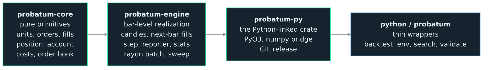
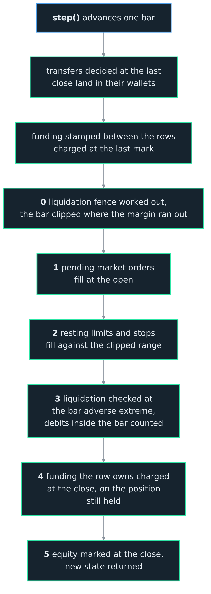

<h1>OCEΛNO <small><code>embeddable-market-simulation-library</code></small></h1>

  
  
  
  

  <a href="../README.md">Introduction</a> &nbsp;•&nbsp;
  <a href="Python_API.md">Python API</a> &nbsp;•&nbsp;
  <a href="Specification.md">Specification</a> &nbsp;•&nbsp;
  <a href="RL_Guide.md">RL Guide</a> &nbsp;•&nbsp;
  <a href="Plotting.md">Plotting</a> &nbsp;•&nbsp;
  <b>Architecture</b> &nbsp;•&nbsp;
  <a href="Decisions.md">Decisions</a> &nbsp;•&nbsp;
  <a href="Contributor_Guide.md">Contributor Guide</a> &nbsp;•&nbsp;
  <a href="Validation_Guide.md">Validation Guide</a>

 
 
 
 

## Architecture

The library is a cargo workspace: a pure-Rust core exposed to Python through one extension module. The dependency order is bottom-up, and logic flows up, never sideways. A lower layer never reaches for a higher one, and the Python-specific concerns (numpy, the GIL) live only in the one crate that links Python.

 

### Crates

Three crates, each building only on the one beneath it:

1. **`probatum-core`** (pure Rust; no Python, no candle series, no parallelism). The fidelity-neutral primitives: unit newtypes, the OHLCV bar, the order and fill types, the netted position, and the account (its spot and margin wallets, spot and perp equity, funding, liquidation, realized and unrealized PnL), the cost model, and the fixed-slot resting order book. This is the reuse seam a future tick or L2 engine would share, so nothing here holds the candle series, the windows over it, or any bar-level fill logic.
2. **`probatum-engine`** (pure Rust; no Python). The bar-level realization: the shared candle series with zero-copy windows, the next-bar fill model, the single `step()` state machine, the optional reporter and its stats, and the Rayon batched runner. It builds only on `probatum-core`. An inverse contract runs there as a linear perpetual in the reciprocal of the price, its position the dollars its contracts are worth, so the closed forms carry over with no branch on the step's path, and `Units` turns its contracts and dollar prices into the engine's terms and its records back ([ADR 0016](Decisions.md)).
3. **`probatum-py`** (the only Python-linked crate; PyO3, compiled to `probatum._probatum`). A thin shell over `probatum-engine`: it parses arguments, copies candles once from numpy, hands state back as a typed record, plays a script of decisions through the engine in one call for the comparison with the reference simulator, vends the zero-copy observation view, and releases the GIL around the batched step. It holds no simulation logic.

The Python package `probatum` re-exports the compiled `Engine` and `Batch` and adds everything that is not simulation. Four of those are drivers, and they hold no simulation logic of their own: `probatum.backtest` and `probatum.rl` wrap the engine's loop, and `probatum.tune` and `probatum.walk_forward` orchestrate many backtests, across worker processes for the first and as one composite pass for the second (ADRs 0032, 0034). `probatum.Market` carries the eleven engine knobs once and hands out those surfaces so they cannot drift apart (ADR 0002). The rest look at a run rather than producing one: `probatum.metrics` evaluates a finished result, `probatum.ta` is functions of arrays that never see the engine, and `probatum.chart` draws. These are the larger half of the package by line count and none of them simulates anything, which is the line that matters: a defect here is a wrong number about a correct run.

`probatum-engine` also carries an in-core sweep that drives compiled Rust strategies over a parameter grid; it is not exposed to Python, since it can only run strategies compiled into the engine, and it survives as the Criterion benchmark of the GIL-free path (ADR 0003).

 

  
  
<i>The dependency order is bottom-up and logic flows up, never sideways: the <code>probatum-core</code> primitives, then <code>probatum-engine</code>, then the one Python-linked crate <code>probatum-py</code>, then the thin <code>python/probatum</code> wrappers.</i>

 

### The step lifecycle

`reset()` positions at the first bar; `reset_at(offset)` starts at an arbitrary bar, which is how the RL env gives each env a different slice of history. `step()` advances exactly one bar, resolves it, then marks and returns the state.

The defining rule is **no same-bar lookahead**: an order decided while looking at bar `t` is resolved against bar `t+1`, never the bar the decision saw. Within a step the events follow the bar, numbered as the engine's own comments number them:

Transfers decided at the last close land first, before any fill, so cash moved into the margin wallet backs the orders decided with it ([ADR 0008](Decisions.md)). Funding stamped between the last row and this one, across a closure or a hole in the data, is charged next, at the last marks, on the positions carried through it, where the path below starts ([ADR 0020](Decisions.md)).

0. The liquidation path is solved next, before anything resolves. Every perp held moves along one synchronous adverse path, from its last mark to its open and from the open to its adverse extreme, and the point where the margin runs out is a point on it; everything past that belongs to a market the account had already left, so every held perp's bar is clipped there. A clip on the gap closed the account before the bar opened, so that is closed first and nothing on a perp fills. Funding stamped inside the bar counts on the bar from the open, as `intrabar` decides ([ADR 0017](Decisions.md)).
1. Pending market orders fill at the open.
2. Resting limit and stop orders fill against the bar's range (a gap through a limit still fills at the limit, never better; a triggered stop fills at the worse of open and trigger).
3. The path is solved again for the account the fills left, every leg opened during the bar joining it at its fill price, with any funding stamped inside the bar counted as `intrabar` decides. A forced close takes the account over where the margin ran out rather than at the bar's extremes, so a loss cannot exceed the margin behind it, books what the wallet then holds as the liquidation charge, and cancels every perp order the account left behind ([ADR 0018](Decisions.md)).
4. The funding the row owns is charged at the closes on the positions still held, after the check, because a stamp at the bar's end comes after every price the bar printed; an account the check closed out, having paid what it counted, pays nothing more, and one a debit takes to its trigger is closed at the closes ([ADR 0020](Decisions.md)).
5. Equity is marked at the close, and the new state is returned.

Steps 1 and 2 read the clipped bars, which is what makes the clip a rule about the account's existence rather than a rule about exit orders.

 

  
  
<i>The events resolved within one <code>step()</code>, in order: transfers, funding between the rows, the liquidation path, market fills, resting fills, the check on the path, the funding the row owns, then the close mark.</i>

 

Equity is the authoritative account value, both wallets together: the cash in both, with every spot holding at its close and every perpetual's unrealized PnL at its close beside it. The `realized_pnl` field is cumulative realized trading PnL and is never added on top of equity.

 

### Zero-copy and batching

The candle series lives once behind an `Arc<[Candle]>`, so thousands of envs share it with no duplication; each env is an independent cursor with its own account and orders. Two consequences follow:

- **Observations are views.** A single env's observation is a read-only numpy view straight onto the shared candle buffer, no copy. `Candle` is `repr(C)`, so a window of candles reinterprets directly as a `(window, 5)` float array; the view is read-only because the buffer is shared, and it keeps the engine alive so the data outlives it. The batched observation gathers each env's window into a fresh `(num_envs, window, 5)` array, or `(num_envs, window, N, 5)` for a universe of N, since the windows differ once envs start at different offsets. See [ADR 0040](Decisions.md).
- **The batched step is GIL-free.** `Batch.step_all` applies a batched action array and steps every env in parallel on the Rayon pool with the Python GIL released. Because the envs are independent and there is no cross-env reduction, batched stepping is bit-identical to stepping each env in a loop, an invariant asserted by a test, but under `intrabar="random"`, where each env draws from a stream named with its index as well.

 

### Reporting

By default the engine records nothing but the running state, so its memory does not grow with the length of the run. With `report=True` it keeps an equity curve, sampled each step, the ledger, a row per bar from the opening balance, the round trips, a log of every fill and a log of every order's events ([ADRs 0022, 0023](Decisions.md)). Performance statistics (return, CAGR, Sharpe, Sortino, Calmar, drawdown, volatility, and the trade metrics over the closed round trips) are derived from the curve and the round trips. Reporting stays off for RL and is never part of the state the agent sees.

 

### Why the seam

The bar engine is the approximate, bar-level member of a planned family. A future sibling is a high-precision tick and L2 engine; the members differ by fidelity tier, not by brand. `probatum-core` is where they meet: the position, the account, the costs, and the order book are the same regardless of how a fill is resolved, so a tick engine reuses them and only replaces the resolution layer that `probatum-engine` provides. That is why L2 is refused at this tier rather than bolted on.
