<h1>OCEΛNO <small><code>probatum</code></small></h1>


<div style="padding-top: 0px;">
  <a href="https://github.com/atOCEANO/probatum/releases"></a>
  <a href="https://www.python.org/downloads/"></a>
  <a href="https://www.rust-lang.org/"></a>
  <a href="https://gymnasium.farama.org/"></a>
  <a href="https://github.com/atOCEANO/probatum/releases"></a>
  <a href="https://opensource.org/licenses/MIT"></a>
</div>

<sub>
  <a href="../README.md">Introduction</a> &nbsp;•&nbsp;
  <a href="Research_Guide.md">Research Guide</a> &nbsp;•&nbsp;
  <a href="RL_Guide.md">RL Guide</a> &nbsp;•&nbsp;
  <b>Charts</b> &nbsp;•&nbsp;
  <a href="Python_API.md">Python API</a> &nbsp;•&nbsp;
  <a href="Specification.md">Specification</a> &nbsp;•&nbsp;
  <a href="Venue_Notes.md">Venue Notes</a> &nbsp;•&nbsp;
  <a href="Validation_Guide.md">Validation Guide</a> &nbsp;•&nbsp;
  <a href="Decisions.md">Decisions</a> &nbsp;•&nbsp;
  <a href="Architecture.md">Architecture</a> &nbsp;•&nbsp;
  <a href="Contributor_Guide.md">Contributor Guide</a>
</sub>

<br>
<br>
<br>
<br>

## Charts

`result.chart()` draws a run and `data.chart()` draws bars, each with arrays of your own beside them. Every number on a chart is the Data's, the Result's, yours, or what `probatum.stats` reads of the Result: the chart computes no indicator and knows no indicator's name ([0042](Decisions.md)).

**`show()` draws it in a notebook cell**, zoomable and pannable in place, and stores it in the `.ipynb`, so the notebook reopened shows it with no kernel running. **`save(path)` writes one HTML file** that opens in a browser offline. Either follows its reader's theme, light or dark.

Every image on this page is drawn by `dev/charts/build.py` from the frozen [sample data](https://github.com/atOCEANO/sample-market-data), Binance's spot pairs at five minutes resampled, each the output of the call printed beside it; the [Contributor Guide](Contributor_Guide.md) has the stage that runs it.

The examples stand on the names this block binds, `frame` being a frame of hourly bars and `SmaCross` the strategy [Naming the window once](#naming-the-window-once) writes out; `universe` is a Data of several pairs, built as `data` is from a frame of each, and every other name an example reads is bound on the page before it:

```python
import numpy
import probatum
from probatum.chart.marks import (
    Background, Band, Histogram, Level, Line, Marker, Markers, Panel, Recorder,
    at_bar, at_next, ramp,
)

data  = probatum.Data(frame, symbol="BTCUSDT", market="spot")
close = data.close

result   = probatum.backtest(SmaCross(fast=20, slow=50), data=data, venue="binance_spot")
strategy = result.policy                       # the copy of the strategy the run decided with
```

<br>

### What it draws

**A run**, here `breakout`, a channel breakout's over a year of hourly bars whose strategy `dev/charts/build.py` writes out: its candles, an arrow at each end of every round trip on the bar it filled on, the strategy's own arrays, the account's equity with its drawdown shaded from the running peak, and four of its statistics above the plot.

```python
breakout.chart(
    breakout.policy.marks(),
    focus=(5_568, 6_528),
    title="A channel breakout with a MACD filter, BTCUSDT 1h, binance spot",
).show()
```

<div align="center">
  <picture>
    <source media="(prefers-color-scheme: dark)" srcset="imgs/charts/run-dark.png">
    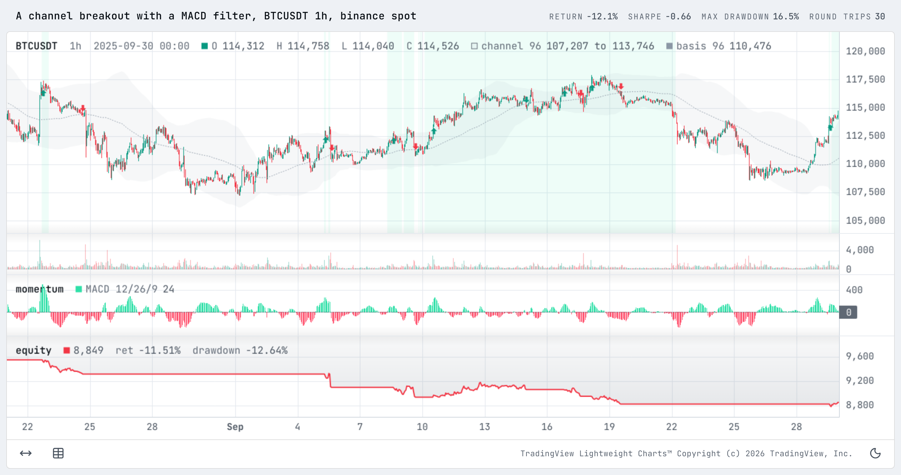
  </picture>
  <p style="margin: 0;"><i>A year's run framed on forty days. The channel, its basis, the regime, the MACD and an arrow where the MACD held an entry back are the arrays the strategy decided on, which its <code>marks()</code> method names (<a href="#naming-the-window-once">Naming the window once</a>)</i></p>
</div>

<br>

An entry's arrow is in its side's colour, under the bar for a long and over it for a short, and an exit's in the win or the loss colour; a trip still open runs to the last bar with no exit. The equity is drawn in the win colour at or above its opening balance and in the loss colour below.

**Its round trips.** The table button opens the trade log under the plot, each trip with its fees, funding, return, best, worst and reason. A click on a column's head sorts it, a click on a row frames that trip, and a click on an arrow opens its row.

<div align="center">
  <picture>
    <source media="(prefers-color-scheme: dark)" srcset="imgs/charts/table-dark.png">
    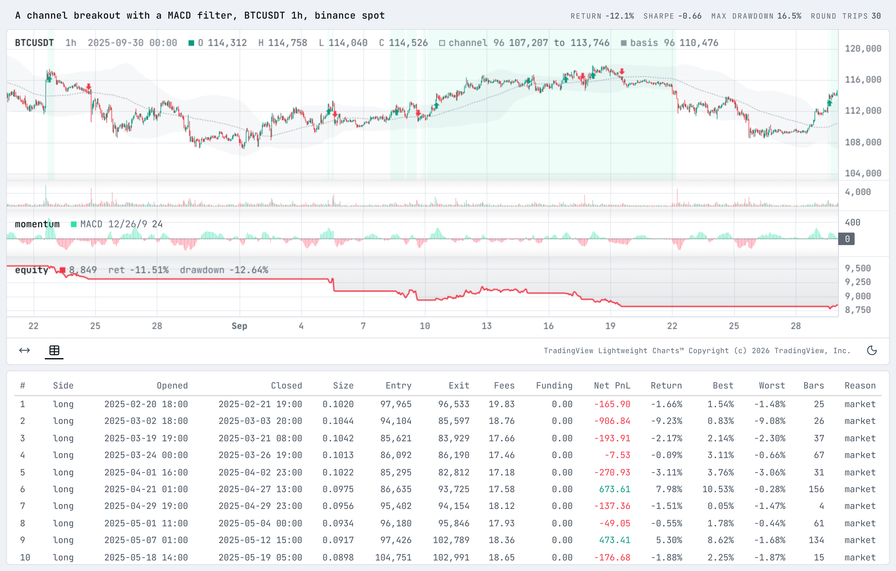
  </picture>
  <p style="margin: 0;"><i>The same run, its trade log open</i></p>
</div>

<br>

**The price four ways.** `price=` draws `"candles"`, the default, `"hollow"` candles, where a rising candle is its outline, `"bars"`, or a `"line"` of the closes:

```python
data.chart(price="hollow", focus=160).show()
data.chart(price="bars", focus=160).show()
data.chart(price="line", focus=160).show()
```

<div align="center">
  <picture>
    <source media="(prefers-color-scheme: dark)" srcset="imgs/charts/price-hollow-dark.png">
    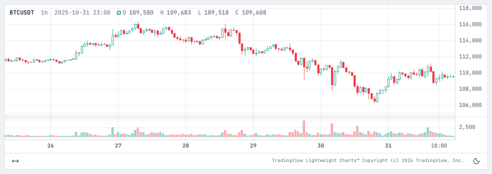
  </picture>
  <p style="margin: 0;"><i>Hollow candles, on the last 160 hours of October 2025</i></p>
</div>

<br>

<div align="center">
  <picture>
    <source media="(prefers-color-scheme: dark)" srcset="imgs/charts/price-bars-dark.png">
    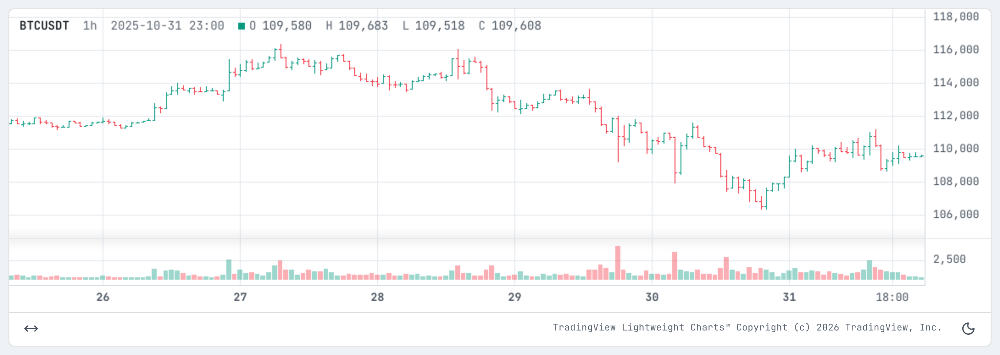
  </picture>
  <p style="margin: 0;"><i>Bars, on the same hours</i></p>
</div>

<br>

<div align="center">
  <picture>
    <source media="(prefers-color-scheme: dark)" srcset="imgs/charts/price-line-dark.png">
    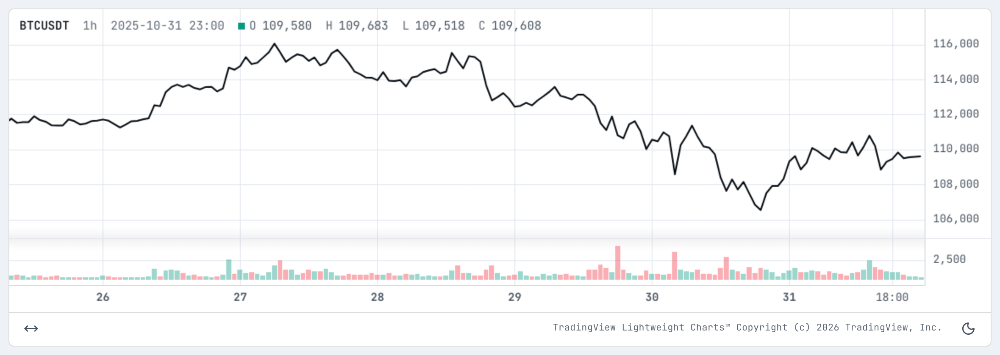
  </picture>
  <p style="margin: 0;"><i>A line of the closes, on the same hours</i></p>
</div>

<br>

**Arrays of your own**, on the price where they leave the candles room and on panels of their own where a name asks for one:

```python
close = data.close
bands = probatum.ta.bbands(close, length=48, deviations=2.0)
rsi   = probatum.ta.rsi(close, length=14)
hist  = probatum.ta.macd(close, fast=12, slow=26, signal=9).histogram

data.chart(
    Band(bands.upper, lower=bands.lower, name="bands 48", fill="#4d9fff14"),
    Line(probatum.ta.sma(close, length=200), name="SMA 200", color="#8b97a5", width=1),
    Line(rsi, name="RSI 14", panel="RSI"),
    Level(value=70.0, panel="RSI", style="dotted"),
    Level(value=30.0, panel="RSI", style="dotted"),
    Histogram(hist, name="MACD 12/26/9", panel="MACD",
              color=numpy.where(hist >= 0.0, "#2fe0a8", "#ff5470")),
    focus=400,
).show()
```

<div align="center">
  <picture>
    <source media="(prefers-color-scheme: dark)" srcset="imgs/charts/indicators-dark.png">
    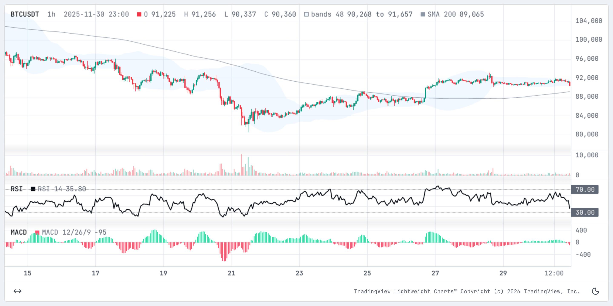
  </picture>
  <p style="margin: 0;"><i>A band and an average over the candles, the RSI and the MACD on panels of their own</i></p>
</div>

<br>

**[One instrument of several](#one-instrument-of-several)**, the whole account's equity beside one instrument's candles and round trips:

```python
weights = numpy.where(universe.closes > probatum.ta.sma(universe.closes, length=200),
                      1.0 / universe.closes.shape[1], 0.0)

book = probatum.backtest(weights, data=universe, venue="binance_spot")
book.chart(instrument="ETHUSDT", focus=24 * 60,
           title="Four pairs above their 200-hour average, ETHUSDT of the four").show()
```

<div align="center">
  <picture>
    <source media="(prefers-color-scheme: dark)" srcset="imgs/charts/universe-dark.png">
    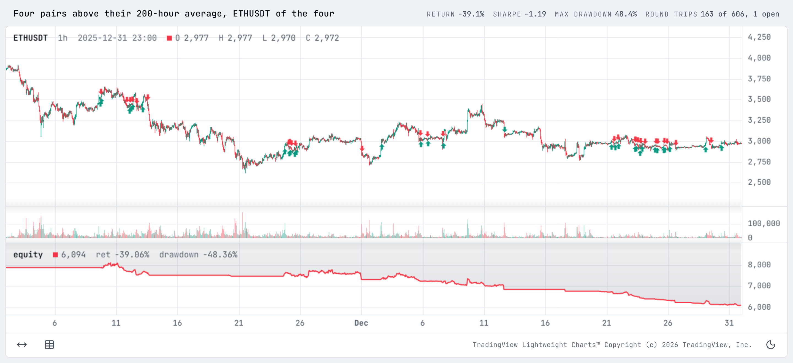
  </picture>
  <p style="margin: 0;"><i>ETHUSDT's round trips of an account of four pairs, the equity the account's</i></p>
</div>

<br>

### Small charts, whole

Each picture is the output of the call above it, on six months of hourly BTCUSDT, with these arrays of its bars and `vam`, a volatility-adjusted momentum:

```python
def vam(close, n):
    logret = numpy.log(close / probatum.ta.shift(close))
    return numpy.log(close / probatum.ta.shift(close, bars=n)) / (
        probatum.ta.stdev(logret, length=n) * numpy.sqrt(n))


rsi          = probatum.ta.rsi(close, length=14)
bands        = probatum.ta.bbands(close, length=20, deviations=2.0)
upper, lower = bands.upper, bands.lower

atr      = probatum.ta.atr(data.high, low=data.low, close=close, length=14)
risk_off = atr > probatum.ta.sma(atr, length=100)

fast, slow = probatum.ta.sma(close, length=20), probatum.ta.sma(close, length=50)
crossed    = probatum.ta.crossover(fast, other=slow)
trending   = close > probatum.ta.sma(close, length=50)

fast_z = vam(close, n=24)
slow_z = vam(close, n=168)
```

**A moving average over the candles.**

```python
data.chart(Line(probatum.ta.sma(data.close, length=50), name="SMA 50")).show()
```

<div align="center">
  <picture>
    <source media="(prefers-color-scheme: dark)" srcset="imgs/charts/ex-line-dark.png">
    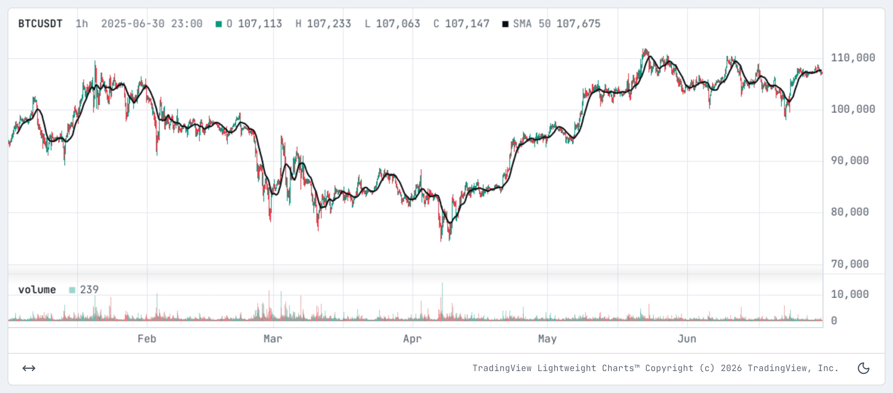
  </picture>
  <p style="margin: 0;"><i>No panel asked for: an array that leaves the candles at least half the price panel is drawn over them</i></p>
</div>

<br>

**An oscillator** on a panel of its own, with the levels that make it readable.

```python
data.chart(
    Line(rsi, name="RSI 14", panel="rsi"),
    Level(value=70.0, panel="rsi", style="dotted"),
    Level(value=30.0, panel="rsi", style="dotted"),
).show()
```

<div align="center">
  <picture>
    <source media="(prefers-color-scheme: dark)" srcset="imgs/charts/ex-oscillator-dark.png">
    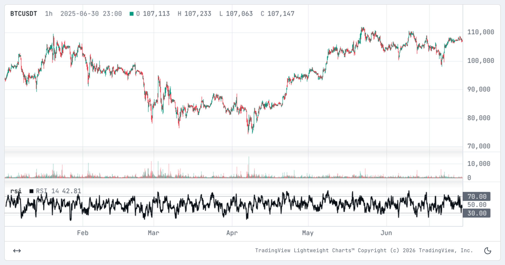
  </picture>
  <p style="margin: 0;"><i>The RSI on the panel its panel= names, its two levels beside it</i></p>
</div>

<br>

**A channel**, shaded between its edges.

```python
data.chart(Band(upper, lower=lower, name="bollinger", fill="#8b97a51a")).show()
```

<div align="center">
  <picture>
    <source media="(prefers-color-scheme: dark)" srcset="imgs/charts/ex-band-dark.png">
    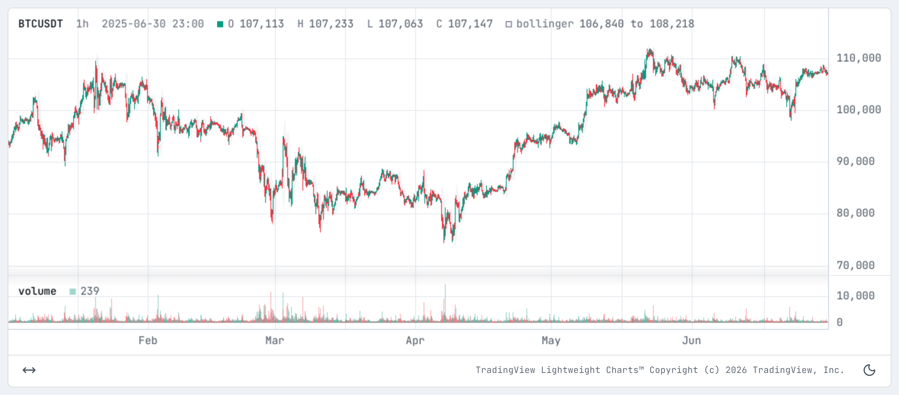
  </picture>
  <p style="margin: 0;"><i>One mark holding two edges; a single number as the lower edge makes it a threshold instead</i></p>
</div>

<br>

**The bars a filter calls risk-off**, shaded.

```python
data.chart(Background(risk_off, name="risk off", fill="#ff547026")).show()
```

<div align="center">
  <picture>
    <source media="(prefers-color-scheme: dark)" srcset="imgs/charts/ex-background-dark.png">
    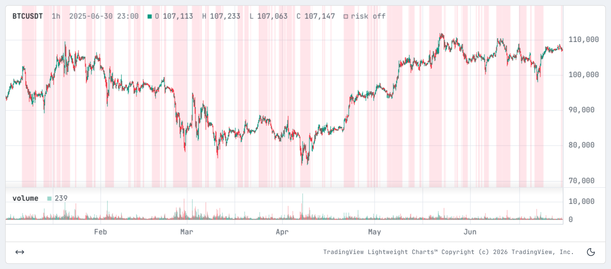
  </picture>
  <p style="margin: 0;"><i>A boolean array painted behind the bars, named so the legend says which region the crosshair is over</i></p>
</div>

<br>

**A glyph wherever a condition holds**, which is Pine's `plotshape`.

```python
data.chart(Markers(crossed, shape="arrow_up", offset=-16)).show()
```

<div align="center">
  <picture>
    <source media="(prefers-color-scheme: dark)" srcset="imgs/charts/ex-markers-dark.png">
    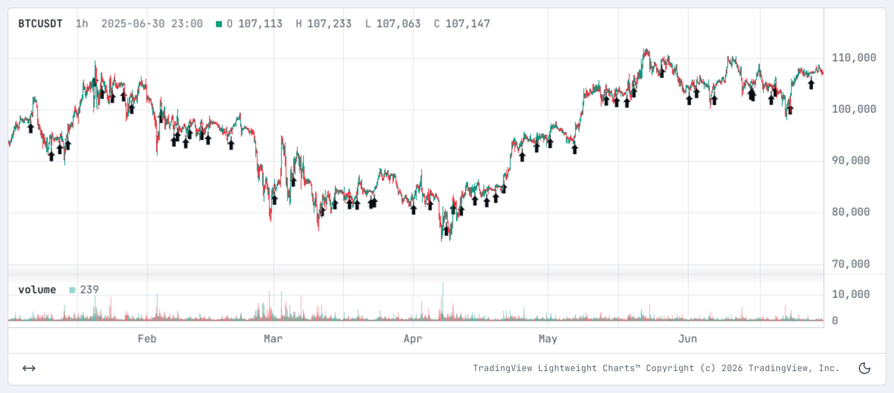
  </picture>
  <p style="margin: 0;"><i>One Markers rather than one Marker a bar, which is also one thing for the renderer to draw</i></p>
</div>

<br>

**The candles tinted** by a condition.

```python
data.chart(candle_color=numpy.where(trending, "#4d9fff", None)).show()
```

<div align="center">
  <picture>
    <source media="(prefers-color-scheme: dark)" srcset="imgs/charts/ex-candle-color-dark.png">
    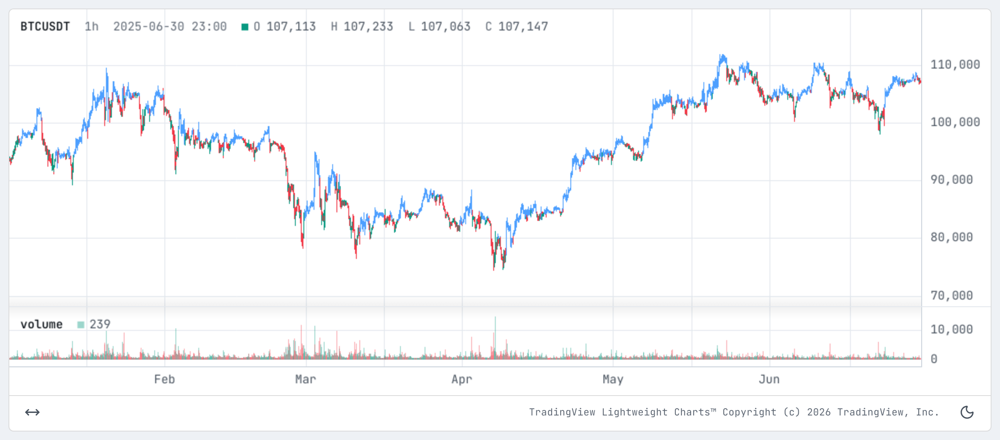
  </picture>
  <p style="margin: 0;"><i>candle_color is Pine's barcolor; None leaves a bar its own colour</i></p>
</div>

<br>

**Two features, a panel each**, pinned to one range so they compare.

```python
data.chart(
    Line(fast_z, name="z 24", panel="z24"),
    Line(slow_z, name="z 168", panel="z168"),
    panels=[Panel(name="z24", range=(-5.0, 5.0)), Panel(name="z168", range=(-5.0, 5.0))],
).show()
```

<div align="center">
  <picture>
    <source media="(prefers-color-scheme: dark)" srcset="imgs/charts/ex-panels-dark.png">
    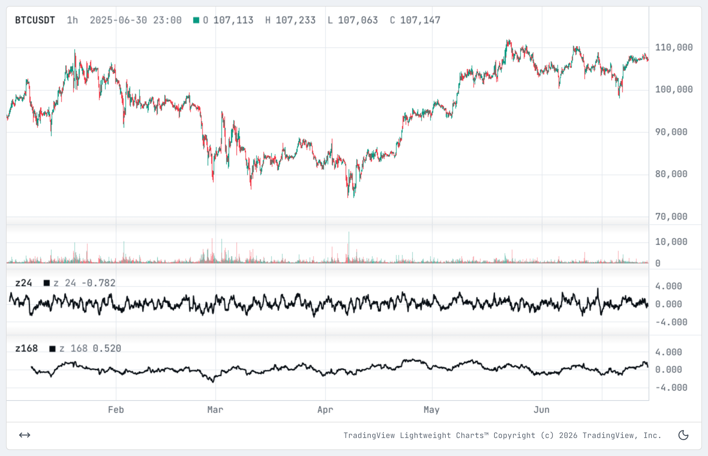
  </picture>
  <p style="margin: 0;"><i>Both panels pinned to the same range</i></p>
</div>

<br>

**A file for someone with no Python.**

```python
result.chart(title="SMA 20/50, BTCUSDT 1h").save(path="run.html")
```

<br>

## Before there is a strategy

`data.chart` needs no run, which is where most research starts: bars, an idea, and the question of whether the idea says anything. Start with the feature beside the price it should explain, here the `vam` the small charts define.

```python
data.chart(
    Line(vam(data.close, n=72), name="vam 72", panel="vam"),
    Level(value=0.0, panel="vam", style="dotted"),
).show()
```

<div align="center">
  <picture>
    <source media="(prefers-color-scheme: dark)" srcset="imgs/charts/ex-feature-dark.png">
    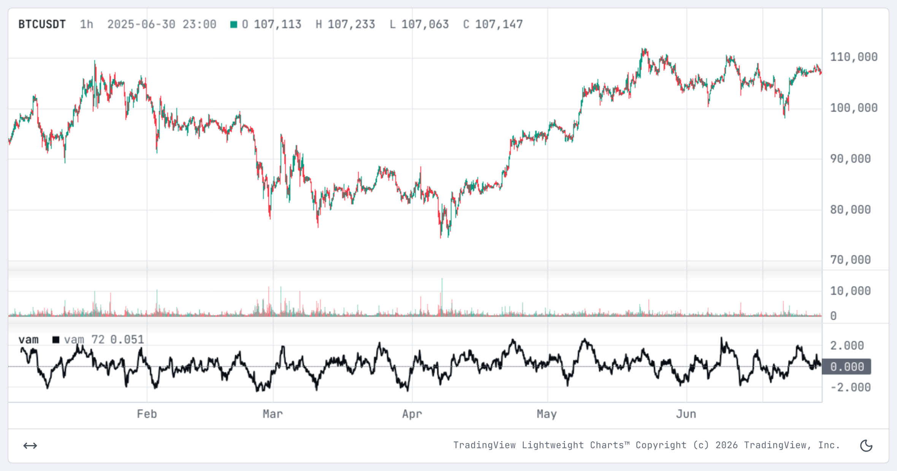
  </picture>
  <p style="margin: 0;"><i>A feature beside the price it should explain</i></p>
</div>

<br>

Then the same feature at several lookbacks, a panel each, **all pinned to one range**: panels scaled to their own data are not comparable, and three of them side by side look alike when they are not.

```python
vam24, vam72, vam168 = vam(close, n=24), vam(close, n=72), vam(close, n=168)

data.chart(
    Line(vam24, name="vam 24", panel="vam24"),
    Line(vam72, name="vam 72", panel="vam72"),
    Line(vam168, name="vam 168", panel="vam168"),
    panels=[
        Panel(name="vam24", range=(-5.0, 5.0)),
        Panel(name="vam72", range=(-5.0, 5.0)),
        Panel(name="vam168", range=(-5.0, 5.0)),
        Panel(name="volume", show=False),
    ],
    height=940,
).show()
```

Then the feature's extremes against what they are meant to predict, the next four hours. **A forward return belongs to the bar it starts on.** It is four values short, and padding its head, which the length rule would also accept, puts `forward[k]` at bar `k + 4`: the trailing return drawn under a label saying forward. Pad the tail:

```python
forward = numpy.concatenate([close[4:] / close[:-4] - 1.0,
                             numpy.full(shape=4, fill_value=numpy.nan)])
shade   = ramp(vam72, colors=["#ff5470", "#8b97a5", "#2fe0a8"], domain=(-3.0, 3.0))
regime  = numpy.where(vam72 > 2.0, "hi", numpy.where(vam72 < -2.0, "lo", "flat"))

data.chart(
    Background(regime, fill={"hi": "#2fe0a81f", "lo": "#ff54701f"}),
    Line(vam72, name="vam 72", panel="vam", color=shade),
    Band(vam72, lower=2.0, only="above", panel="vam", fill=("#2fe0a800", "#2fe0a859")),
    Line(forward, name="fwd 4h", panel="fwd"),
    Level(value=0.0, panel="fwd", style="dotted"),
    candle_color=numpy.where(numpy.abs(vam72) > 2.0, "#4d9fff", None),
    title="vam 72 extremes against the next four hours",
).show()
```

<div align="center">
  <picture>
    <source media="(prefers-color-scheme: dark)" srcset="imgs/charts/ex-verdict-dark.png">
    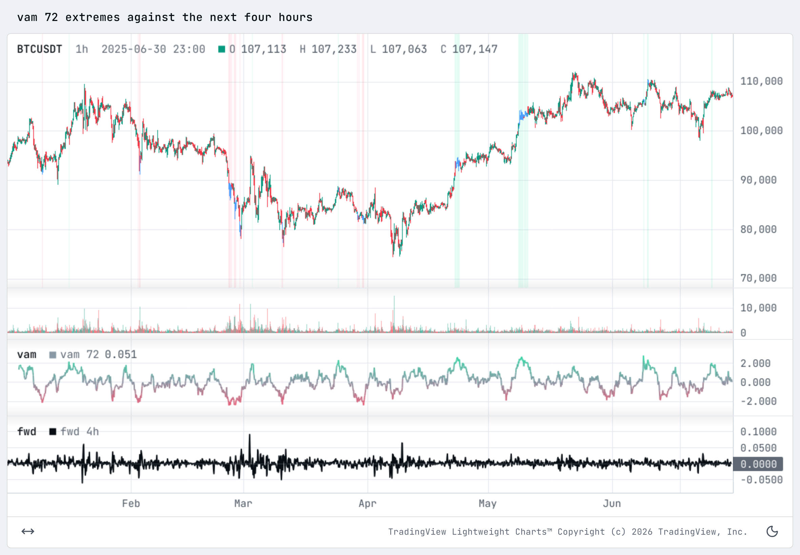
  </picture>
  <p style="margin: 0;"><i>The extremes shaded, the candles tinted, and the next four hours on a panel of their own</i></p>
</div>

<br>

## Your own arrays

A numpy array, a pandas Series or a list all work, and all are read **by position**, one value a bar of the Data. A Series' index is never read, so align it yourself.

**Draw the strategy's own arrays, not a fresh copy.** `result.policy` is the copy of the strategy the run used, so its arrays are the values the fills were decided on. A moving average recomputed outside it can differ from the traded one by a warm-up or an off-by-one.

```python
result.chart(
    Line(strategy.fast_line, name="SMA 20"),
    Line(strategy.slow_line, name="SMA 50"),
).show()
```

<br>

### Naming the window once

The calls above write `20` twice, as `fast=20` and in the legend. A `marks()` method on the strategy says it once, and it is an ordinary method: nothing calls it during a run, so a search pays nothing for it.

```python
class SmaCross(probatum.Strategy):
    def __init__(self, fast=20, slow=50):
        self.fast, self.slow = fast, slow

    def init(self, data):
        self.fast_line = probatum.ta.sma(data.close, length=self.fast)
        self.slow_line = probatum.ta.sma(data.close, length=self.slow)
        self.warmup = self.slow

    def next(self, bar, account):
        up = self.fast_line[bar.i] > self.slow_line[bar.i]
        if account.position == 0.0 and up:
            account.target(weights=1.0)
        elif account.position > 0.0 and not up:
            account.close()

    def marks(self):
        return [
            Line(self.fast_line, name=f"SMA {self.fast}"),
            Line(self.slow_line, name=f"SMA {self.slow}", style="dashed"),
        ]
```

```python
result.chart(strategy.marks()).show()
```

A list of marks is flattened like any other, so what the strategy declares and what you add at the call compose:

```python
result.chart(
    strategy.marks(),
    Line(result.baselines["buy_and_hold"], name="buy and hold", panel="equity"),
).show()
```

<br>

### The length contract

Two lengths are accepted, and they mean different things ([0042](Decisions.md)).

| Length | Drawn from |
| :--- | :--- |
| `T` | bar 0: entry `i` is bar `i`. |
| `T - 1` | bar 1: entry `i` is bar `i + 1`, as `numpy.diff` gives it. |

A third, `T + future`, is accepted where `future=` has given the axis room for it; see [Drawing past the last candle](#drawing-past-the-last-candle). Any other length raises a `ProbatumValueError` that names both numbers, since a silent trim or pad draws a chart off by an amount no one can see:

```text
Line 'f': 4000 values for 8760 bars; give 8760, one a bar, or 8759, drawn from bar 1 as a diff is
```

A `T - 1` array draws late because drawing a short array early is what lookahead looks like on a chart. It is not a claim about when a value could first be known: a number read inside `next` was known **on** its bar, and passed one short it draws one bar right of the candles it explains, which raises nothing, since both lengths are legal.

**`Recorder` says which you meant where the meaning is plain**, while writing `next`. It collects values under a name and an alignment, and hands back one value a bar of the Data:

```python
class Carry(probatum.Strategy):
    def init(self, data):
        self.log = Recorder(data)

    def next(self, bar, account):
        self.log.at_bar(bar, leverage=account.leverage, flat=account.position == 0.0)
        self.log.at_next(bar, close=bar.close)


carried = probatum.backtest(Carry(), data=data, venue="binance_spot")
carried.chart(Line(carried.policy.log["leverage"], name="leverage", panel="risk")).show()
```

`at_bar` records a value already true on the bar `next` was handed, and `at_next` one the next bar is tested against, such as a stop level. A bar `next` never reached is a gap, and a boolean one is `False`, so a warm-up needs no padding. One key holds one kind and one alignment, and changing either raises. It costs an array write per value per bar, so leave it out of a strategy you mean to search over.

`at_bar` and `at_next` are the same two rules as functions of an array you already have, such as a list `next` appends to, one value a bar but the last:

```python
class Levered(probatum.Strategy):
    def init(self, data):
        self.leverage = []

    def next(self, bar, account):
        self.leverage.append(account.leverage)


levered = probatum.backtest(Levered(), data=data, venue="binance_spot")
data.chart(Line(at_bar(levered.policy.leverage), name="leverage")).show()
```

Both pad a boolean with `False` rather than NaN, since `numpy.array([numpy.nan]).astype(bool)` is `True`, and a mask padded the way a float is reports its condition on the one bar it knows nothing about. A `Background` mask is read the same way: a NaN or a `pandas.NA` shades nothing.


**A run's own arrays are on the rows it recorded**: its equity, its baselines and its round trips' bars. Those are all the Data's rows unless a row printed no bar of the run's instruments, as one of a selection from a universe can, or the Result was taken part way through its run. Then an array as long as the run's rows is refused rather than drawn off its bars, and a diff one row shorter is refused with it, since the two cannot be told apart by length. Give a diff as `numpy.diff(x, prepend=numpy.nan)`, and put a run's array on the Data's rows first:

```python
# the Data's row of each of the run's
rows = numpy.searchsorted(data.time, v=result.time)

placed = numpy.full(shape=len(data), fill_value=numpy.nan)
placed[rows] = result.baselines["buy_and_hold"]

result.chart(Line(placed, name="buy and hold", panel="equity")).show()
```

<br>

### A NaN is a gap

A value that does not exist stops the line ([0042](Decisions.md)). It is never dropped, since dropping it would make its two neighbours adjacent: a trailing stop on bars 0 to 40 and again on bars 900 to 940 would draw a line through the 860 bars it was not there. The renderer joins across a missing value on its own, so a gapped series is drawn as one renderer series per run of values. Each hole costs one series, and a leading run of NaN costs nothing, since it is carried as an offset. Infinities are gaps too.

<br>

## Colour

**`color`** is the mark itself: a line's stroke, a histogram's columns, a band's edges, a marker's glyph. **`fill`** is an area: under a line, between a band's edges, behind the bars for a background.

`color` takes one value **or one a bar**, so a line can carry a second variable in its own colour. One a bar follows the length contract, and `None` leaves that bar alone. `Level` and `Marker`, which draw one shape, take one colour and refuse an array, naming the substitute.

`fill` takes **one colour or a gradient**, and a `Band`'s **one a bar** as well, so a region can change colour with a condition; a `Line`'s fill is one area under one line, which takes one. Here an Ichimoku cloud, its edges drawn 26 bars ahead, is green where its first edge is on top and red where its second is:

```python
def midpoint(data, n):
    return (probatum.ta.highest(data.high, length=n)
            + probatum.ta.lowest(data.low, length=n)) / 2.0


lead     = numpy.full(shape=26, fill_value=numpy.nan)
senkou_a = numpy.concatenate([lead, (midpoint(data, n=9) + midpoint(data, n=26)) / 2.0])
senkou_b = numpy.concatenate([lead, midpoint(data, n=52)])

data.chart(
    Band(senkou_a, lower=senkou_b,
         fill=numpy.where(senkou_a >= senkou_b, "#2fe0a833", "#ff547033")),
    future=26,
).show()
```

`Background` is the exception, with a colour for each label through a `{label: colour}` map.

```python
data.chart(Line(fast, name="SMA 20", color=numpy.where(fast >= slow, "#2fe0a8", "#ff5470"))).show()
```

`ramp` turns numbers into colours, so the line becomes a gradient in which every shade is a value:

```python
data.chart(Line(fast, name="SMA 20",
                color=ramp(probatum.ta.roc(fast, length=1),
                           colors=["#ff5470", "#8b97a5", "#2fe0a8"]))).show()
```

The domain is the values' own finite range unless `domain=` pins it, so a ramp compares inside one chart but not across two; pin it when two charts have to agree. A non-finite value is left out of the domain and returns `None`.

`candle_color=` is Pine's `barcolor()`, a keyword of the chart rather than a mark, since the candles are the Data's. Here it tints the bars the run held:

```python
# the Data's row of each of the run's
rows = numpy.searchsorted(data.time, v=result.time)

held = numpy.zeros(shape=len(data), dtype=bool)
for trade in result.trades:
    last = rows[-1] if trade["open"] else rows[trade["close_bar"]]
    held[rows[trade["open_bar"]]:last + 1] = True

result.chart(strategy.marks(), candle_color=numpy.where(held, "#4d9fff", None)).show()
```

<div align="center">
  <picture>
    <source media="(prefers-color-scheme: dark)" srcset="imgs/charts/ex-held-dark.png">
    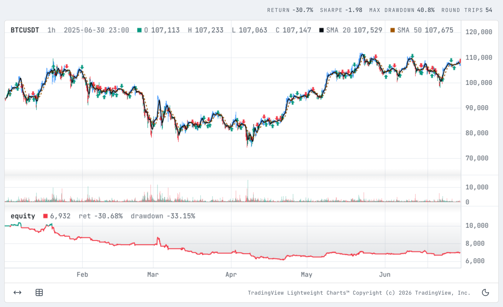
  </picture>
  <p style="margin: 0;"><i>The bars the run held, which the equity curve alone does not show</i></p>
</div>

<br>

## Panels

`"price"` always exists, comes first and carries the candles. `"volume"` appears where the volume is not dead, `"equity"` on a run's chart, and any other name the first time a mark's `panel=` gives it. The drawdown is shaded onto the equity panel rather than given a panel, unless `drawdown="panel"` asks for one.

**A bare array overlays the candles unless that costs them more than half the price panel** ([0042](Decisions.md)); otherwise it gets a panel of its own. The rule is about the picture, never your intent, and it cannot flatten the candles. `panel=` overrides it, `panel="price"` included.

`panels=` **configures** the panels the chart has, its own and those the marks make, and never creates one, so a name it does not know configures nothing. Listing panels fixes their order relative to each other, and never moves them relative to the panels left out.

```python
result.chart(
    Line(rsi, name="RSI 14", panel="momentum"),
    panels=[
        Panel(name="momentum", weight=1.6, range=(0.0, 100.0)),
        Panel(name="equity", weight=2.0, scale="log"),
    ],
).show()
```

`show=False` removes a panel and everything on it, and a hidden panel ships no data. `weight` is a stretch against the other panels rather than pixels, so a layout holds at any size. A panel named only for its scale or its range keeps its own weight: price 5, volume 1, equity 2 and any other 1.5. `scale` is `"linear"`, `"log"` or `"percent"`, the **A / L / %** buttons every panel draws on its axis, so a reader can change it in the saved file. Log on the equity panel draws compounding as a straight line.

<br>

### Turning off what a run brings

A run brings its arrows, its trade log, and an equity panel with the fall from its running peak shaded onto it. Each can be turned off.

The shading **is** the drawdown, as `probatum.stats.drawdown` reads it: it runs from the equity up to the highest equity the run had reached by that bar, so it closes on every new high and is widest at the worst bar, and its deepest point is the record's `max_drawdown_pct`. The legend prints it beside the balance.

```python
result.chart(
    trades=False,                                    # no arrows, no table
    drawdown="panel",                                # a pane of its own instead
    panels=[Panel(name="equity", scale="percent")],  # the same curve, as a return
).show()
```

`drawdown` is `"under"`, `"panel"` or `False`. A pane of its own suits a **linear** equity axis, on which a shaded fall is in the quote currency and a late twenty percent draws taller than an early one; on a log axis equal percentages are equal distances. `probatum.chart.defaults(drawdown="panel")` sets it for every later chart, and `Panel("equity", show=False)` removes the panel with its shading.

A percent axis is read per series, from each one's first **visible** point, so two series that start on different bars are measured from different anchors until the view is past the later start.

**The drawdown is not the equity as a percentage.** A percent axis rescales the same curve; the drawdown measures the fall from the running peak, zero on every new high. On one bar a run can be up since its first and eight percent below its high, and only the drawdown shows the second.

<br>

## The marks

```python
from probatum.chart.marks import (
    Panel, Line, Histogram, Band, Level, Marker, Markers, Background, Recorder,
    ramp, at_bar, at_next,
)
```

| Mark | What it draws |
| :--- | :--- |
| `Line(values, name, ...)` | a line through your values. `step=True` holds each value until the next, which suits a position or a discrete action. |
| `Histogram(values, name, ...)` | columns from `base` to your values. |
| `Band(upper, lower, name, ...)` | a shaded region between two edges. `lower` may be one number, so a channel and a threshold are one mark. |
| `Level(value, name, ...)` | a horizontal line across the panel. |
| `Marker(bar, ...)` | one annotation at one bar. |
| `Markers(mask, ...)` | a glyph on every bar a condition holds, Pine's `plotshape`. |
| `Background(values, name, ...)` | shading behind the bars on a condition; a `name` puts the region under the crosshair in the legend. |
| `Panel(name, *, show=True, weight=None, scale="linear", range=None)` | a panel's settings, given in `panels=`: whether it shows, its stretch against the others, its scale and a fixed range. |
| `ramp(values, *stops, colors=, domain=)` | numbers to colours, one a value. |
| `Recorder(bars)` | values collected inside `Strategy.next` with their alignment declared, `bars` a Data or its length. |
| `at_bar(values)`, `at_next(values)` | the same two rules as functions of an array you already have. |

`Band` with `only="above"` or `"below"` is the conditional fill an overbought shading is: it exists only where the upper edge is past the lower, and its gradient runs from that edge toward each excursion's own extreme, so a brief poke past the level shades faintly and a deep one shades hard.

```python
result.chart(
    Line(rsi, name="RSI 14", panel="momentum"),
    Level(value=70.0, panel="momentum", style="dotted"),
    Band(rsi, lower=70.0, only="above", panel="momentum", fill=("#ff547000", "#ff547059")),
    Band(rsi, lower=30.0, only="below", panel="momentum", fill=("#2fe0a800", "#2fe0a859")),
).show()
```

<div align="center">
  <picture>
    <source media="(prefers-color-scheme: dark)" srcset="imgs/charts/ex-zones-dark.png">
    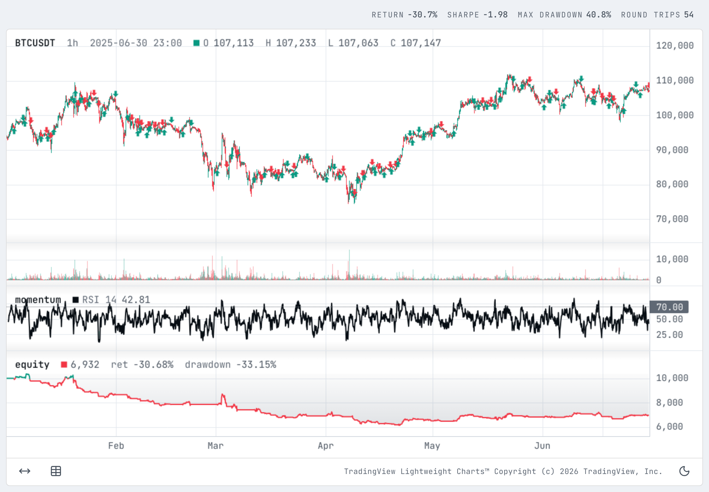
  </picture>
  <p style="margin: 0;"><i>Two zones on one oscillator, each only where the reading is past its level</i></p>
</div>

<br>

`Background` takes a boolean mask for one region, or an array of labels for several, with a `{label: colour}` map in which a label it leaves out shades nothing, which keeps a three-state background readable.

```python
data.chart(Background(regime, name="volatility",
                      fill={"hi": "#4d9fff29", "lo": "#ff547033"})).show()
```

With a `name` it takes a legend row reading the region under the crosshair; without one it draws and stays out of the legend. A mask has no region names, so its row is the swatch and the name.

`Marker`'s **`offset` is a signed distance in pixels**, positive upward, so the glyph keeps its distance from the bar at every zoom. Its `shape` is `"circle"`, `"square"`, `"arrow_up"`, `"arrow_down"`, `"triangle_up"`, `"triangle_down"`, `"diamond"`, `"cross"` or `"flag"`. To anchor on the panel's own scale, pass `value=`, a price only on the price panel; without one the marker sits at the bar's own extreme.

`Markers` is the same glyph on every bar a mask is true on:

```python
data.chart(Markers(probatum.ta.crossover(fast, other=slow), shape="arrow_up", offset=-16)).show()
```

`probatum.ta.crossover` pads its warm-up with `False`, since `bool(nan)` is `True` and a float warm-up would fire on the bars where nothing is known. `Markers` takes `Marker`'s keywords, and its `value=` can be an array, so each glyph sits on its own bar's reading. **The mask must be boolean or integer**: a float mask is how a comparison arrives after a NaN, and it is refused.

<br>

## What raises

What depends on the bars only the chart can check, and it refuses rather than draws something plausible. Every refusal is one of probatum's errors, named for the argument as you typed it.

| Refused | Because |
| :--- | :--- |
| a series of a length the contract does not accept | the message names both numbers. |
| a logarithmic panel whose data reaches zero | the bar is named. |
| a Result among the marks | another run's equity is a `Line` on the equity panel. |
| an array as long as the rows a run recorded, where those are not all the Data's | drawn as the Data's it would land off its bars; see [the length contract](#the-length-contract). |
| `data=` with bars of another fingerprint | the run's round trips would land on bars it never read. |
| no `instrument` on a Data of several | the candles are one instrument's. |
| a book of several accounts | its accounts ran on bars of their own. |

A keyword given a value outside its own vocabulary raises where you wrote it, as `Level(nan)` does. Everything else degrades in the open, with a `probatum.ProbatumWarning`. A volume that is all zero or constant draws no volume panel **and warns**, since a dead feed draws as a plausible flat chart. A `Level` with no `panel=` goes on the price panel, and **warns** where its value is far from the candles, since the axis does not scale to a level and `Level(70)` beside a coin at 61,000 is off screen.

<br>

## `focus`

A round trip of the run's, from `result.trades`, a `(start, end)` pair of bars, or `N`, the last `N` bars. It moves the view and never slices the bars, so every marker stays on its own bar, and its bounds are clamped rather than refused.

```python
worst = min(result.trades, key=lambda trade: trade["pnl"])

result.chart(strategy.marks(), focus=worst).show()
```

<div align="center">
  <picture>
    <source media="(prefers-color-scheme: dark)" srcset="imgs/charts/ex-focus-dark.png">
    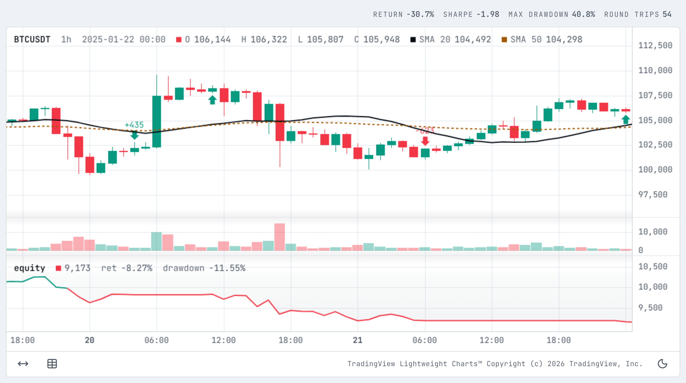
  </picture>
  <p style="margin: 0;"><i>focus moves the view and never slices the bars</i></p>
</div>

<br>

## One instrument of several

On a Data of several instruments, `instrument=` names whose candles are drawn. On a run, only the round trips the run made on that instrument are drawn, and the equity panel and the headline are the whole account's, which the title says unless you give one; its round trips read as that instrument's of the account's, `16 of 65`.

```python
universe.chart(instrument="ETHUSDT").show()

pair = probatum.backtest(numpy.full(shape=(len(universe), 2), fill_value=0.4),
                         data=universe, venue="binance_spot")
pair.chart(
    Line(pair["ETHUSDT"].weight, name="weight", panel="weight", step=True),
    instrument="ETHUSDT",
).show()
```

A bar the instrument printed none on keeps its slot on the axis with no candle, and the legend over it says `no bar`. A run on a selection of the instruments sees only the rows they printed, so its equity and its round trips are drawn on the Data's rows they belong to, and its marks stay one value a bar of the Data.

<br>

## A Result that keeps no Data

A Result loaded with `Result.load`, unpickled, or recorded below the full level keeps no Data, so `data=` gives it. It is held to the fingerprint the run recorded, so a chart can only be of the bars the run read.

```python
kept = probatum.backtest(SmaCross(), data=data, venue="binance_spot", record="account")
kept.chart(data=data).show()
```

<br>

## Output

```python
chart = result.chart(title="SMA cross 20/50, BTCUSDT 1h")

chart.show()                            # inline in a notebook cell
chart.save(path="reports/run.html")     # one self-contained file
chart.spec()                            # the underlying document, for tests
```

`show` embeds an iframe whose content is stored in the `.ipynb`. A chart left as a cell's last line is drawn the same way with no `show()`, and `show()` draws one anywhere in a cell, as inside a loop. Outside a notebook `show` raises and points at `save`.

<br>

### Where it renders

A chart is an iframe carrying its whole document inline, with no script tag, module loader or URL in the cell's output, so every frontend that renders an iframe draws it.

Two places it will not draw, since the host removes the iframe first:

- **An untrusted notebook.** JupyterLab and Notebook 7 strip HTML output from a notebook you did not run yourself; Trust Notebook once.
- **GitHub's notebook viewer**, which strips iframes and scripts. Export with `nbconvert --to html`, or save the charts as files and link them.

`title=` and `stats=` are drawn above the plot, the title on the left and the numbers on the right, so a saved file says which run over which period it is.

```python
result.chart(
    title="SMA cross 20/50, BTCUSDT 1h, binance spot",
    stats=["total_return_pct", "sharpe", "max_drawdown_pct", "exposure_pct"],
).save(path="reports/cross.html")
```

A run shows four by default, its return, Sharpe, maximum drawdown and round trips, named as `result.stats` names them, and `stats=[]` shows none. The numbers are formatted in Python, so the renderer only draws the pairs it is given.

<br>

### Notes

`notes=` puts a table of your own under the plot, open as the chart opens and above the trade log, the one button showing and hiding both: a pandas or polars DataFrame, a pyarrow Table, or rows whose first names the columns.

```python
result.chart(
    title="each stretch traded on parameters fitted only on the bars before it",
    notes=[
        ["window", "fitted on", "traded", "sharpe"],
        [1, "2025-01-01 to 2025-06-30", "2025-07-01 to 2025-09-30", 1.94],
        [2, "2025-04-01 to 2025-09-30", "2025-10-01 to 2025-12-31", 0.71],
    ],
).save(path="reports/walk.html")
```

A probatum Table goes in as `table.to_pandas()`, such as a validation's `study.windows`, a row each stretch one fit traded.

<div align="center">
  <picture>
    <source media="(prefers-color-scheme: dark)" srcset="imgs/charts/ex-notes-dark.png">
    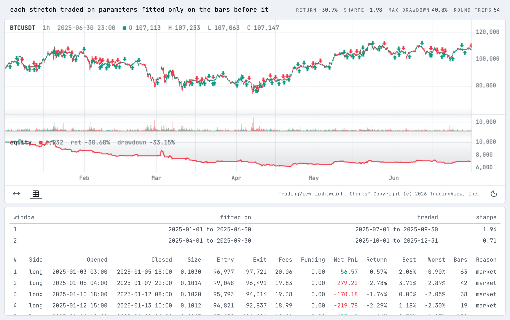
  </picture>
  <p style="margin: 0;"><i>What produced the picture, carried by the file rather than the cell that made it</i></p>
</div>

A DataFrame's index is not drawn, so `reset_index()` keeps it as a column, and every cell is written as text.

<br>

### Comparing runs

One run is drawn in full and the others as curves, since two sets of trade arrows on one chart cannot be read. Chart the run you are studying, with the others' equity on its equity panel:

```python
# neighbours maps your name for each run to its Result
stack = numpy.stack([run.equity for run in neighbours.values()])

win.chart(
    Band(stack.max(axis=0), lower=stack.min(axis=0), name="neighbours", panel="equity",
         fill="#8b97a51f"),
    [Line(run.equity, name=label, panel="equity", color="#8b97a5", width=1)
     for label, run in neighbours.items()],
    panels=[Panel(name="equity", weight=3.0, scale="log")],
).show()
```

<br>

### Size

`height` is a **notebook cell's**, in pixels and at least 120, and `show(height=)` overrides it for one display without rebuilding anything. A **saved file sizes itself to its window**, so one file is right on a laptop and on a wide monitor, and another page can embed it in an iframe of its own size.

```python
chart = result.chart(height=420)

chart.show()                      # a 420px cell
chart.show(height=900)            # the same document, drawn taller
chart.save(path="run.html")       # fills whatever window opens it
```

There is no width: a chart fills whatever contains it, and panels are sized by `weight` for the same reason. It opens on every bar, its narrowest bar set from the plot's width and the bars it holds, and frames them again as a cell settles to its width until the reader moves the view.

A year of hourly candles in a notebook cell is a fraction of a pixel a bar. Every bar is still fitted, and below one device pixel of bar spacing the candles are **aggregated to the column**, one drawn candle a pixel, from the first bar's open to the last's close and reaching the extremes of all of them; zooming in undoes it. The legend reads a real bar rather than the aggregate. The time axis holds one grain at a time, so at a year it names months.

<br>

### What it costs

Every chart carries its own copy of the renderer, about 200 KB, beside its data, paid into the `.ipynb` once a chart. A chart whose data passes 8 MB warns and names how many bars to chart instead. Sharing one copy would have the iframes reach into the page around them, which is what would stop a saved file working on its own. Fewer charts with more panels cost less: a chart of five panels carries one renderer.

Set the look once:

```python
probatum.chart.defaults(theme="dark", height=560, price="hollow")
```

Both palettes travel in every document, so a saved file switches between light and dark offline, and `theme` names the one it opens on. The candles rise green and fall red, and the rest is drawn in neutral inks. `palette` overrides colours inside either theme. Its names are `surface`, `plane`, `grid`, `axis`, `ink`, `ink2`, `muted`, `hairline`, `up`, `down`, `win`, `loss`, `s1` to `s4` and `selected`, and `wick_up`, `wick_down`, `volume_up` and `volume_down`, which follow the bodies unless given. A colour is `#rgb`, `#rgba`, `#rrggbb`, `#rrggbbaa`, `rgb()` or `rgba()`, and a name the chart does not draw or a colour it cannot read is refused. `theme` and `palette` given on a chart replace the session's for that chart rather than merging with them.

```python
result.chart(theme="auto", palette={"light": {"s1": "#00695c"}}).save(path="report.html")
```

`theme="auto"`, the default, opens on the notebook's own theme where the chart can see the page around it, as in JupyterLab and VS Code, and otherwise on whichever the reader's system asks for, which the author of a chart cannot know.

The renderer's notice and a link to TradingView, which its licence asks the page to give, sit in the footer beside the fit, trade log and theme buttons ([0042](Decisions.md)), and nothing is painted over the plot. The buttons are Lucide's icons, whose licence travels in every document's stylesheet.

<br>

## Drawing past the last candle

Some series are computed from real bars but belong ahead of them: an Ichimoku cloud sits 26 bars ahead, as does a projected pivot or a regression carried forward. `future=` gives the axis room for them, by the Data's own interval.

```python
data.chart(Band(senkou_a, lower=senkou_b, name="cloud", fill="#2fe0a833"),
           future=26, focus=180).show()
```

The axis grows and the candles do not, so only a series reaches past the last bar.

<div align="center">
  <picture>
    <source media="(prefers-color-scheme: dark)" srcset="imgs/charts/chart-projection-dark.png">
    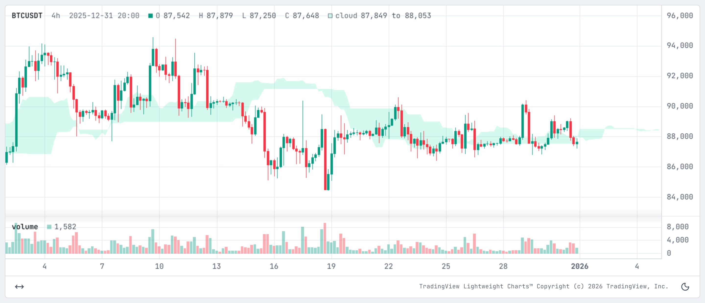
  </picture>
  <p style="margin: 0;"><i>The cloud runs on past the last candle, over an axis that carries no bar; four-hour bars of 2024 and 2025, framed on the last 180</i></p>
</div>

<br>

No mark is displaced by bars. In Pine, `plot(offset=26)` makes one name mean the displaced value inside `plot()` and the undisplaced one inside an expression, so a rule can disagree with its picture. Here one array has one meaning, and the axis is what grows: the lead is your own, in the series' start bar where it can be read. A negative displacement needs nothing: a lagging line such as the Chikou is `T` long and draws where it is.

<br>

## What cannot be charted

- **No intrabar path.** A bar is four numbers; a fill happened somewhere inside it, and the chart draws nothing between them.
- **No single fills.** The arrows are round trips, so an entry built from three adds is one arrow at their average price; the fill log is `result.fills`.
- **No order book, queue position or latency.** The engine models none.
- **No training rollout.** An environment keeps no trade log while it trains; chart the agent's backtest, an ordinary Result.
- **No axis but time.** A feature against its forward return, or the average path after an event, is a scatter.
- **No guard against your own lookahead.** Everything is computed once from fixed arrays, so a chart cannot repaint, but a centred rolling window knows the future and is drawn as given. The fills obey the engine's rule even where a signal does not, and `search` checks a strategy's decisions against cut bars ([Python API](Python_API.md#search)).

<br>

## Where it sits

`python/probatum/chart/__init__.py` builds the document, `python/probatum/chart/marks.py` holds the marks, and the vendored renderer is under `python/probatum/_static/`, beside TradingView's licence and notice, which every chart's document carries as it carries the icons' licence. It needs the standard library and numpy alone: pandas is read by duck typing and never imported, and IPython is imported only inside `show`.
