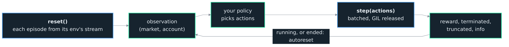

<h1>OCEΛNO <small><code>embeddable-market-simulation-library</code></small></h1>


<div style="padding-top: 0px;">
  <a href="https://github.com/atOCEANO/embeddable-market-simulation-library/releases"></a>
  <a href="https://www.python.org/downloads/"></a>
  <a href="https://www.rust-lang.org/"></a>
  <a href="https://opensource.org/licenses/MIT"></a>
</div>

<sub>
  <a href="../README.md">Introduction</a> &nbsp;•&nbsp;
  <a href="Python_API.md">Python API</a> &nbsp;•&nbsp;
  <a href="Specification.md">Specification</a> &nbsp;•&nbsp;
  <b>RL Guide</b> &nbsp;•&nbsp;
  <a href="Plotting.md">Plotting</a> &nbsp;•&nbsp;
  <a href="Architecture.md">Architecture</a> &nbsp;•&nbsp;
  <a href="Decisions.md">Decisions</a> &nbsp;•&nbsp;
  <a href="Contributor_Guide.md">Contributor Guide</a> &nbsp;•&nbsp;
  <a href="Validation_Guide.md">Validation Guide</a>
</sub>

<br>
<br>
<br>
<br>

## RL Guide

`probatum.env` steps `num_envs` accounts at a venue on a Data's bars together in Rust, as a Gymnasium vector environment, `probatum.rl.VectorEnv`. Each account is a backtest's: a step takes each environment's action at the close of its bar, decides from it at that close, and returns the observation and the reward at the next, through the same fills, costs, funding, caps and liquidation a backtest runs. Each environment draws its episodes from a stream of its own, so an episode is found again from its environment and its number whatever `num_envs` is, and runs again as a backtest from its start ([Specification](Specification.md#the-environment), [ADR 0038](Decisions.md)).

<br>

<div align="center">
  
  <p style="margin: 0;"><i>The vectorized loop: observe, act, step every environment at once with the GIL released, read the reward; an episode that ends resets as autoreset says, on the next step by default (ADR 0038).</i></p>
</div>

<br>

```python
import probatum

env = probatum.env(data, "binance_perp", window=64, num_envs=8, seed=0)
print(env.single_observation_space)             # Box(-inf, inf, (328,), float32)
print(env.single_action_space)                  # Box(-1.0, 1.0, (1,), float32)
obs, info = env.reset(seed=0)                   # (8, 328) float32
for _ in range(1_000):
    actions = env.action_space.sample()         # (8, 1), a target weight each
    obs, reward, terminated, truncated, info = env.step(actions)
env.close()
```

`data` is a Data of one instrument's bars, from the router or a frame. With no features the market block is the candles: 64 bars of five values, then four account values for the instrument and four for the account, 328 in all. An action is a target weight, scaled by `max_leverage`. A plain `import probatum` never loads Gymnasium; `probatum.env` and `probatum.rl` load it when first reached.

<br>

## Training

The quick path is Stable-Baselines3. `probatum.sb3.wrap` presents the environment as an SB3 `VecEnv` and switches it to same-step autoreset and to an observation of its own each step, which SB3 expects, so a stock PPO trains on it:

```python
import stable_baselines3

env = probatum.env(train, "binance_perp", window=32, num_envs=8, seed=0)
agent = stable_baselines3.PPO("MlpPolicy", probatum.sb3.wrap(env))
agent.learn(total_timesteps=100_000)
agent.save("agent")
```

One adapter serves every SB3 algorithm: PPO, A2C and SAC on the default `Box`, and DQN on `actions="discrete"` over one instrument, whose space is a `Discrete`. The agent spec rides on a copy of the action space, which SB3 saves into the model's zip, so a model loaded again is backtested as it trained. SB3's vector wrappers compose on top unchanged, to log episodes and normalise the observation and reward, and `probatum.sb3.SpecCallback` copies `VecNormalize`'s statistics of the observation into the spec after each rollout, so a backtest normalises the observation as training did:

```python
import stable_baselines3.common.vec_env

venv = stable_baselines3.common.vec_env.VecNormalize(
    stable_baselines3.common.vec_env.VecMonitor(probatum.sb3.wrap(env)))
agent = stable_baselines3.PPO("MlpPolicy", venv)
agent.learn(total_timesteps=100_000, callback=probatum.sb3.SpecCallback())
```

`probatum.sb3` needs stable-baselines3, which the `[sb3]` extra pulls in (probatum is not on PyPI, so install from a release as the [README](../README.md#install) shows).

<br>

### Own the loop

The environment is a plain Gymnasium vector environment, so a single-file policy-gradient or actor-critic loop, the CleanRL shape, reads the batched observation and writes a batched action with no adapter at all. A minimal REINFORCE on discrete actions, PyTorch yours to bring:

```python
import numpy
import torch

env = probatum.env(train, "binance_perp", window=32, actions="discrete", num_envs=512,
                   seed=0)
obs, _ = env.reset(seed=0)
policy = torch.nn.Sequential(torch.nn.Linear(obs.shape[1], 128), torch.nn.Tanh(),
                             torch.nn.Linear(128, 3))
optimiser = torch.optim.Adam(policy.parameters(), lr=3e-4)
restarted = numpy.zeros(env.num_envs, dtype=bool)

for _ in range(200):
    logps, rewards, alive, kept = [], [], [], []
    for _ in range(32):                                    # a short rollout
        dist = torch.distributions.Categorical(logits=policy(torch.as_tensor(obs)))
        actions = dist.sample()
        obs, reward, terminated, truncated, _ = env.step(actions.numpy())
        ended = terminated | truncated
        logps.append(dist.log_prob(actions))
        rewards.append(torch.as_tensor(reward, dtype=torch.float32))
        alive.append(torch.as_tensor(~ended, dtype=torch.float32))
        kept.append(torch.as_tensor(~restarted, dtype=torch.float32))
        restarted = ended

    returns, running = [], torch.zeros(env.num_envs)       # cut at each episode's end
    for reward, mask in zip(reversed(rewards), reversed(alive)):
        running = reward + 0.99 * running * mask
        returns.insert(0, running)
    returns = torch.stack(returns)
    returns = (returns - returns.mean()) / (returns.std() + 1e-8)
    loss = -(torch.stack(logps) * returns * torch.stack(kept)).mean()
    optimiser.zero_grad()
    loss.backward()
    optimiser.step()
```

Under the default next-step autoreset the step after an episode ends resets that environment and ignores its action, so `kept` leaves that step out of the loss, and `alive` keeps a discounted return from running across an episode's end.

<br>

## The settings

Only `data` and `venue`, a Venue or a preset's name, have no default.

| Argument | Default | What it sets |
| :--- | :--- | :--- |
| `window` | `64` | The bars of the market block, up to the close. |
| `features` | `None` | A `(T, N, F)` array or a function of a Data that returns one, read as `probatum.Data.features` reads them; the candles over their last close without them. |
| `fill` | `None` | What a NaN feature on a bar its instrument printed past its warm-up becomes: a number, or `"previous"`; such a NaN is refused without it. |
| `layout` | `"flat"` | One float32 vector, or `"dict"` of `market` and `account`. |
| `actions` | `"box"` | `"box"`, `"simplex"`, `"discrete"` or `"orders"`. |
| `max_leverage` | `1.0` | The gross weight a box action reaches, and a discrete action's step times the slots. |
| `max_offset` | `20` | The ticks from the close an order's offset reaches. |
| `decode` | `None` | `decode(actions, state)`, the `(B, N)` weights in place of the decoding `actions` names. |
| `reward` | `"log"` | `"log"`, `"sharpe"`, or `reward(state)`, the `(B,)` rewards. |
| `episode_length` | `None` | The steps after which an episode is cut; without it only the last bar cuts one. |
| `sample` | `None` | The instruments each episode trades, drawn among those shown at its start; without it every instrument. |
| `costs` | `None` | The `(low, high)` range of `"maker"`, `"taker"`, `"slippage"` and `"impact"` each environment draws its own from once. |
| `tolerance` | `0.0` | The fraction of equity a target leaves a leg undone below. |
| `num_envs` | `1` | The environments stepped together. |
| `threads` | `None` | The threads a step runs on; by default one for each 2^17 floats its observations hold, at most half the CPUs. No result depends on it. |
| `autoreset` | `"next_step"` | Gymnasium's mode: `"next_step"`, `"same_step"` or `"disabled"`. |
| `copy` | `True` | Each observation its own array; `False` hands out one array the next step writes over. |
| `normalise` | `False` | Each market feature written over its mean and deviation across every value the training span's observations hold, which the agent spec keeps. |
| `record` | `"none"` | `"transitions"` is not done yet. |
| `seed` | `None` | The seed every stream is named from, drawn and recorded where it is left out. |

A setting the environment cannot take is refused as it is built, from probatum's tree of errors, naming the setting, what arrived and the fix.

<br>

## Episodes

An episode starts at a bar drawn uniformly among those at which an instrument is shown: one it has entered, printed and not delisted. An instrument enters once a whole window of its features lies past the first bar it printed with every feature finite, so its market cells never hold a value from before it listed or from a feature's warm-up. Before then, after it delists and on any bar it did not print, its cells hold 0.0, never NaN, its shown flag is 0 and its action is ignored.

An episode ends at a liquidation, or where equity falls to the floor, 1% of the opening balance, which makes a liquidation a large finite penalty rather than an infinite one; it is cut at the last bar, or after `episode_length` steps. `sample=k` gives each episode `k` slots drawn among the instruments shown at its start, kept in the Data's order, so one agent trains across many instruments at a fixed shape; a universe of spot and perpetual instruments together is not sampled, since its slots would change kind between episodes.

Each environment `i` draws its episodes from the stream named `episodes i` of the seed, and its costs once from the stream named `costs`, four draws for each environment. Its `k`-th episode and its costs are the same whatever `num_envs` is, and `reset(seed=)` starts the streams of the environments it resets again from that seed, leaving the costs as they were drawn. Every step's info holds each environment's `episode`, `step` and `start`, the Data's row it opened on, and with `sample` its `instruments`, so an episode runs again through `probatum.backtest(weights, data[start:], venue)`.

<br>

## Observation

The observation is float32, the market block and then the account block.
- **Market**, `(W, N, F)` over the window's bars, the slots and their features: with the candles as features, a bar's open, high, low and close each over the instrument's last close, and its volume over the mean of the window's bars it printed.
- **Account**, for each slot its weight, its unrealized PnL over equity, its distance from its entry and whether it is shown; then the account's log return over the step, its leverage, its margin ratio and its cash weight. With `actions="orders"` each slot also reports how many of its orders rest and the nearest one's distance from the close in ticks.

The default layout is one flat `Box`, which SB3's `MlpPolicy`, TorchRL and CleanRL-style scripts take; `layout="dict"` splits the two blocks for a `MultiInputPolicy`. Every value over equity is 0.0 where equity is at or below zero, so no cell is NaN or infinite.

`normalise=True` writes each market feature, the candles' or a function's, over its mean and deviation across every value the training span's observations hold, so an untrained network sees inputs near zero with a spread near one. The scaling is worked in Rust as each observation is written, a cell the observation leaves at 0.0 stays 0.0, the account block is never scaled, and the agent spec keeps both numbers, for bars the agent has not seen to be scaled the same way. A feature whose values lie within a billionth of their size of one another never varies, and is written over a deviation of 1, as 0.0 where it is constant.

<br>

## Actions

| `actions` | Space | Weight |
| :--- | :--- | :--- |
| `"box"` | `Box(-1, 1, (N,))`, a spot slot from 0 | `max_leverage * a / max(1, sum(abs(a)))` over the shown slots, so the gross never passes `max_leverage`. |
| `"simplex"` | `Box(0, 1, (N + 1,))`, the last a cash slot | Each action over the sum of the shown slots' and the cash slot's. |
| `"discrete"` | `Discrete` for one slot, of three choices or two on spot, `MultiDiscrete` for several | Short, flat or long at `max_leverage / N`, a spot slot flat or long. |
| `"orders"` | `Box` of `(N, 2)` | A limit for `abs(size) * max_leverage` of equity, `round(offset * max_offset)` ticks from the close on the passive side, replacing the slot's last; a buy that would be priced at or below zero places none. |

The decision at each close is a target of each shown slot's weight with `tolerance`, so a weight fills at the next open as a backtest's would. `decode(actions, state)` returns the weights itself, once a step for the whole batch over the same state a reward reads, a NaN leaving a slot unnamed. Orders are placed in Rust, so no Python runs per order inside the step.

<br>

## Reward

`reward="log"` pays the step's log return of equity, its equity floored at 1% of the opening balance, so a takeover that leaves nothing after a step from 2,000, on a balance of 10,000, is rewarded `log(100 / 2,000) = -3.00`, and a sale on the book that leaves 1,500 `log(1,500 / 2,000) = -0.29`. `reward="sharpe"` pays the differential Sharpe of those returns, its moments moving at `2 / (window + 1)`, which needs a window of two bars or more.

`reward(state)` is called once a step for the whole batch, so no Python runs per environment. Its `state` holds `(B,)` arrays of `equity`, `previous_equity`, `log_return`, `drawdown`, `leverage`, `turnover`, `fees`, `funding` and `liquidated`, and `(B, N)` arrays of `weights` and `positions`, all read-only:

```python
def reward(state):
    return state.log_return - 0.5 * state.drawdown ** 2 - 0.0005 * state.turnover

env = probatum.env(train, "binance_perp", window=48, reward=reward, num_envs=256)
```

<br>

## Autoreset

| `autoreset` | An episode that ends |
| :--- | :--- |
| `"next_step"`, the default | Resets on the next step, which ignores its action and returns its first observation, a reward of 0.0 and neither flag. |
| `"same_step"` | Resets on the step that ended it, which returns the next episode's first observation, the last one and its info under `final_obs` and `final_info`. |
| `"disabled"` | Stays as it ended, each later step returning its last observation and flags with a reward of 0.0, until `reset(options={"reset_mask": mask})` names it. |

The mode is declared in `metadata["autoreset_mode"]` and as `autoreset_mode`, the `gymnasium.vector.AutoresetMode` member, so a vector wrapper reads it rather than assuming one.

<br>

## What an environment says

`env.describe()` lists what its runs assume, as a backtest's assumptions at its venue on its Data list them, each cost an environment draws shown with its range and marked as set by the user. `env.provenance` records the Data's provenance, the venue, every setting, the seed, drawn where none was given, and the streams each environment draws from.

<br>

## The agent spec

An agent is judged fairly only if a backtest shows it what it saw in training and reads its outputs as they were read, so every environment records `env.agent_spec`, a JSON document of its inputs, its observation, its outputs, its venue and the span it trained on ([Specification](Specification.md#the-agent-spec), [ADR 0039](Decisions.md)):

```json
{
  "schema": 1,
  "window": 64,
  "instruments": ["BTCUSDT", "ETHUSDT"],
  "markets": ["linear", "linear"],
  "slots": 2,
  "sample": null,
  "features": {"custom": "momentum", "width": 2, "source_hash": "b2:a224894254dea50d",
               "reference": "b2:f517e3ebe5808298"},
  "fill": null,
  "normalisation": {"mean": [0.0004, 0.5573], "deviation": [0.0096, 0.2634]},
  "sb3": null,
  "observation": {"size": 268, "layout": "flat", "shape": [64, 2, 2],
                  "account": ["weight", "upnl", "entry_distance", "shown",
                              "weight", "upnl", "entry_distance", "shown",
                              "log_return", "leverage", "margin_ratio", "cash_weight"]},
  "actions": {"space": "box", "low": [-1.0, -1.0], "high": 1.0, "max_leverage": 2.0},
  "decode": {"builtin": "box"},
  "reward": {"builtin": "log", "floor": 0.01},
  "tolerance": 0.0,
  "venue": {"name": "binance_perp", "taken": "2026-10-16", "changed": {"funding": "none"}},
  "training": {"fingerprint": "b2:5f0c2a91e3d84b17a6c09e2d4f81b3c5", "interval": "1h",
               "bars": 8760, "start": "2024-01-01T00:00:00Z",
               "end": "2024-12-31T23:00:00Z"},
  "version": "2.0.0"
}
```

A custom function is never pickled. A feature function is recorded by its name, its width, a hash of its source and a hash of its output, rounded to float32, on probe bars the package builds the same way on every machine, 512 bars of each training instrument on its market, which a function passed again is held to; a function that cannot run there leaves no reference, with a warning that says so. A custom decode is held the same way to its output on eight probe actions, taken the first time the spec is read, so a decode that keeps state of its own meets them then. An array of features is recorded by its width alone, and a custom reward by its name and source, since a backtest never reads a reward. The venue is recorded as the preset it was made from, the day that preset was taken and every setting changed, as its repr shows them, so the spec builds the venue again. `sb3` holds the statistics `SpecCallback` copies in, null until it does.

<br>

## Backtesting an agent

`probatum.backtest` runs a trained agent as it runs a rule, and returns the same `Result` ([Specification](Specification.md#an-agent-in-a-backtest), [ADR 0039](Decisions.md)). The agent is an SB3 model or policy, asked for its deterministic prediction, a recurrent policy's state carried from one close to the next; a torch module, called on the observation as a tensor on its device, in eval mode with no gradient; or any other function of the observation, the first element of a tuple a module or a function returns being its action. It runs as one environment of its spec over the Data from its first bar, recording as a run does. The window reads the bars before a slice, so an agent decides at the slice's first close, and each observation is the one training showed it, normalised as it was. Once the account holds nothing the agent is no longer asked.

```python
agent = stable_baselines3.PPO.load("agent")
result = probatum.backtest(agent, test, "binance_perp")
again = probatum.backtest(result.policy, test, "binance_perp")  # the same equity
```

An SB3 model carries its spec; any other agent is given it as `spec=`: the spec itself, a path to its JSON or to a directory holding `spec.json`, or the environment it trained in. `probatum.save` writes an agent beside its spec, a torch module as its state dict and an SB3 model as its own zip, and never pickles a module. The policy-gradient loop above trains a module whose output is the logits, so a function of the observation turns them into its action:

```python
probatum.save(policy, "agents/reinforce", spec=env)          # weights.pt and spec.json
policy.load_state_dict(torch.load("agents/reinforce/weights.pt"))
greedy = lambda obs: policy(torch.as_tensor(obs)).argmax(dim=1).numpy()
result = probatum.backtest(greedy, test, "binance_perp", spec="agents/reinforce")
```

- **Functions it trained with.** A feature function or a decode is passed again as `features=` or `decode=`, never pickled, and held to its output on its probe, so a changed function is refused with both hashes; an array of features is over the Data given.
- **Instruments.** The Data's instruments must be the spec's, in its order, or `instruments=` names them, and an agent trained with `sample=k` trades any `k` instruments it names; each must be on the market the agent trained on, since a spot slot reads the same action as another weight than a perpetual's.
- **What it decided.** `result.policy` holds each close's weights, or each slot's size and offset for orders as placed, NaN where nothing was decided or a slot was not shown; played again as weights with the spec's `tolerance`, it gives the same equity to the bit. The frictionless baseline is the agent run again without the costs of trading, at once rather than when the baselines are first read, as an agent cannot be copied to be played later, so a full-level backtest asks it twice; `capacity` and the cost sweeps take an agent's settings and leave the baseline out.
- **What it warns.** A run on bars that overlap the training span, at another venue than the one the spec records, or on another interval warns, and the Result's provenance records the spec, the overlap and whether the venue is the one it trained at. An agent trained under `intrabar="random"` is judged under each fixed setting, and each of its Results says it ran at another venue than it trained at.

<br>

## Gymnasium's constructors

`probatum.rl.Env` is one environment as Gymnasium's single API steps it, for Tianshou and CleanRL-style scripts: an episode that ends waits for the next `reset`. Both are registered as `probatum/Trading-v0` once `probatum.rl` or `probatum.env` has loaded:

```python
import gymnasium
import probatum.rl

single = gymnasium.make("probatum/Trading-v0", data=train, venue="binance_perp",
                        window=64)
vector = gymnasium.make_vec("probatum/Trading-v0", num_envs=512, data=train,
                            venue="binance_perp", window=64)
```

`make_vec` builds the same batch `probatum.env` returns. `probatum.rl.Batch` is the raw batch underneath, for a loop of your own ([Python API](Python_API.md#batch)).
