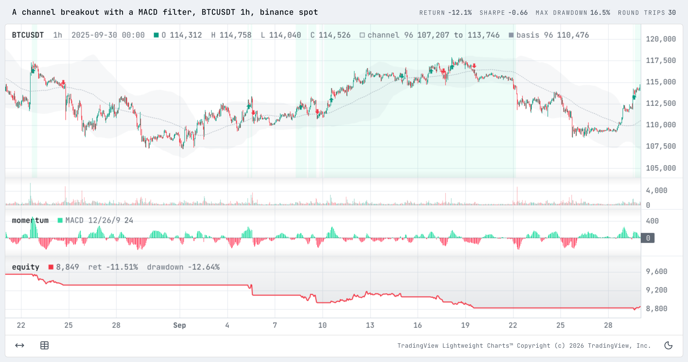

<h1>OCEΛNO <small><code>probatum</code></small></h1>


<div style="padding-top: 0px;">
  <a href="https://github.com/atOCEANO/probatum/releases"></a>
  <a href="https://www.python.org/downloads/"></a>
  <a href="https://www.rust-lang.org/"></a>
  <a href="https://gymnasium.farama.org/"></a>
  <a href="https://github.com/atOCEANO/probatum/releases"></a>
  <a href="https://opensource.org/licenses/MIT"></a>
</div>

<sub>
  <b>Introduction</b> &nbsp;•&nbsp;
  <a href=".Documentation/Research_Guide.md">Research Guide</a> &nbsp;•&nbsp;
  <a href=".Documentation/RL_Guide.md">RL Guide</a> &nbsp;•&nbsp;
  <a href=".Documentation/Charts.md">Charts</a> &nbsp;•&nbsp;
  <a href=".Documentation/Python_API.md">Python API</a> &nbsp;•&nbsp;
  <a href=".Documentation/Specification.md">Specification</a> &nbsp;•&nbsp;
  <a href=".Documentation/Venue_Notes.md">Venue Notes</a> &nbsp;•&nbsp;
  <a href=".Documentation/Validation_Guide.md">Validation Guide</a> &nbsp;•&nbsp;
  <a href=".Documentation/Decisions.md">Decisions</a> &nbsp;•&nbsp;
  <a href=".Documentation/Migration.md">Migration</a> &nbsp;•&nbsp;
  <a href=".Documentation/Architecture.md">Architecture</a> &nbsp;•&nbsp;
  <a href=".Documentation/Contributor_Guide.md">Contributor Guide</a>
</sub>

<br>
<br>
<br>
<br>

## Introduction

`probatum` is **one simulated crypto exchange for backtests, parameter searches and reinforcement learning, stepped bar by bar in Rust**. Every job, a validation among them, replays historical bars through the same fills and the same costs, so a number in one means the same in the others.

Every run is a discrete simulation: it steps every bar in order, and each step settles that bar's orders, fills, funding and margin before the next bar is read. Even an array of weights is stepped this way, so no run is a vectorized backtest; stops, limits, funding and liquidations depend on the path a position took ([0003](.Documentation/Decisions.md)).

The loop runs in Rust, so stepping every bar stays fast. An array runs whole in one call into the engine, a random or grid search runs its trials in parallel, and `probatum.env` steps thousands of accounts at once with the GIL released.

You decide at a bar's close, and your order fills on a later bar, never on the one you saw. Every fill pays the venue's fee, and a market order or a stop also pays half the spread, slippage and impact. On perpetual futures the account pays or receives funding, and it is liquidated when its losses use up its margin.

```python
import pandas
import probatum

data = probatum.Data(pandas.read_parquet(path="btcusdt-1h.parquet"),
                     symbol="BTCUSDT", market="spot")


def trend(data, length):                     # all in above the average, flat below it
    return (data.close > probatum.ta.sma(data.close, length=length)).astype(float)


result = probatum.backtest(trend(data, length=200),
                           data=data, venue="binance_spot")     # one run

study = probatum.search(trend, space={"length": probatum.Int(low=20, high=400)},
                        data=data, venue="binance_spot",
                        sampler="random", holdout=0.3)          # a search of it

env = probatum.env(data, venue="binance_spot", num_envs=4_096)  # accounts for an agent
```

By default a backtest keeps its fills, every order's events, its round trips and one ledger row per bar, as tables that `to_pandas()` turns into frames. It also totals its costs by kind and lists each modelling choice it made, graded `venue`, `simplified` or `optimistic`. `probatum.stats` puts an interval on a statistic where the sample supports one, names the method behind it, and judges a search against every trial it ran.

It is a library your code calls, with no server or scheduler, and it fetches nothing itself. Bars come from a pandas, polars, pyarrow or DuckDB frame, a numpy array, or [exchange-router](https://github.com/atOCEANO/exchange-router). [Scope](#scope) lists what it leaves out.

It works well in a Jupyter notebook. A Result shows in a cell as its summary, and every table and statistic as a pandas frame, or as plain text where pandas is not installed. `result.chart().show()` draws an interactive chart in the cell, in the notebook's theme, and needs no pandas; the `.ipynb` keeps it, so the notebook reopened shows it with no kernel running.

<br>

<div align="center">
  <picture>
    <source media="(prefers-color-scheme: dark)" srcset=".Documentation/imgs/charts/run-dark.png">
    
  </picture>
  <p style="margin: 0;"><i>A channel breakout backtest on BTCUSDT, as result.chart() shows it in a Jupyter notebook, with the indicators the strategy was built on.</i></p>
</div>

<br>
<br>

## Quick Start

probatum needs Python 3.13 or later and is not on PyPI. Each [release](https://github.com/atOCEANO/probatum/releases) carries a wheel for each machine below and a `SHA256SUMS` file with every file's hash. Install yours by its URL:

```bash
# Linux x86_64
pip install "probatum @ https://github.com/atOCEANO/probatum/releases/download/v4.0.0/probatum-4.0.0-cp313-abi3-manylinux_2_28_x86_64.whl"

# Linux aarch64
pip install "probatum @ https://github.com/atOCEANO/probatum/releases/download/v4.0.0/probatum-4.0.0-cp313-abi3-manylinux_2_28_aarch64.whl"

# macOS on Apple silicon
pip install "probatum @ https://github.com/atOCEANO/probatum/releases/download/v4.0.0/probatum-4.0.0-cp313-abi3-macosx_11_0_arm64.whl"

# Windows x64
pip install "probatum @ https://github.com/atOCEANO/probatum/releases/download/v4.0.0/probatum-4.0.0-cp313-abi3-win_amd64.whl"
```

The Linux wheels need glibc 2.28 or later. Any other machine builds the source archive, which needs the [Rust toolchain](https://rustup.rs):

```bash
pip install "probatum @ https://github.com/atOCEANO/probatum/releases/download/v4.0.0/probatum-4.0.0.tar.gz"
```

The package itself needs only numpy. Extras go in brackets before the `@`, as in `"probatum[rl,search] @ <URL>"`:

| Extra | Brings | For |
| :--- | :--- | :--- |
| `rl` | gymnasium | `probatum.env` and the agents trained on it |
| `search` | optuna, cloudpickle | `search`'s default TPE sampler and its worker processes; without them, pass `sampler="random"` or `"grid"` |

Stable-Baselines3 and torch are yours to install, and the adapters that use them print the install line when one is missing. [exchange-router](https://github.com/atOCEANO/exchange-router) fetches bars and funding from the venues' public market data, with no account or API key:

```bash
pip install "git+https://github.com/atOCEANO/exchange-router.git"
```

<br>

### A first run

This runs offline, on 200 days of hourly bars drawn as a random walk. The rule holds the pair while the close is above its 24-hour average:

```python
import numpy
import probatum

rng   = numpy.random.default_rng(seed=7)
close = 30_000.0 * numpy.exp(numpy.cumsum(rng.normal(loc=0.0, scale=0.004, size=4_800)))

open_ = numpy.concatenate([[30_000.0], close[:-1]])
high  = numpy.maximum(open_, close) * 1.001
low   = numpy.minimum(open_, close) * 0.999

bars  = numpy.column_stack([open_, high, low, close,
                            numpy.full(shape=4_800, fill_value=50.0)])
hours = numpy.datetime64("2025-01-01") + numpy.arange(stop=4_800) * numpy.timedelta64(1, "h")
data  = probatum.Data(bars, symbol="BTCUSDT", market="spot", time=hours)

weights = (close > probatum.ta.sma(close, length=24)).astype(float)
result  = probatum.backtest(weights, data=data, venue="binance_spot")
print(result)
```

```text
Result(a (4800, 1) array of weights on probatum.venues.binance_spot, 4,800 bars, equity 10,000.00 to 5,369.51)
```

With pandas installed, `result.summary()` gives the summary as a frame:

```python
print(result.summary().to_pandas()[["run", "buy_and_hold", "low", "high"]].round(decimals=2))
```

```text
                      run  buy_and_hold    low   high
total_return_pct   -46.30        -34.42 -64.68 -17.23
cagr_pct              NaN           NaN    NaN    NaN
volatility_pct      25.63         37.21  24.18  27.11
sharpe              -4.30         -1.88  -7.23  -1.37
max_drawdown_pct    48.58         37.45  27.28  65.95
exposure_pct        46.20           NaN    NaN    NaN
num_trades         254.00           NaN    NaN    NaN
win_rate             0.19           NaN   0.14   0.24
profit_factor        0.52           NaN   0.33   0.83
costs             4304.21           NaN    NaN    NaN
```

A random walk gives the rule nothing to find, and its 254 round trips paid 4,304.21 in costs. `low` and `high` are the ends of the run's 95% interval for each statistic, and the CAGR is left out because the run is shorter than a year.

`result.chart().show()` draws the run in a notebook cell, and `result.chart().save("run.html")` writes it to one file that opens offline.

<br>

### Your own bars

A Data reads any frame with `open`, `high`, `low`, `close` and `volume` columns and the bars' open times in a datetime index or column:

```python
data = probatum.Data(pandas.read_parquet(path="btcusdt-1h.parquet"),
                     symbol="BTCUSDT", market="spot")
```

A perpetual preset charges the funding events that come with the bars and refuses bars with none. To run perpetual bars of your own without funding, use `probatum.venues.bybit_perp.replace(funding="none")`. exchange-router fetches bars with their funding:

```python
from exchange_router import Router

with Router.local(exchanges=["bybit"]) as router:
    data = probatum.Data.from_router(router, exchange="bybit", market="linear",
                                     interval="1h", symbols=["BTCUSDT"],
                                     start="2025-01-01", funding=True)

data.save(path="bars/btc-2025")                    # Arrow files, loaded back unchanged
data = probatum.Data.load(path="bars/btc-2025")
```

`"linear"` asks for the venue's linear perpetuals, margined in a quote currency such as USDT or USDC, and `"spot"` for its spot pairs.

<br>

### A strategy

A `Strategy` decides at each close, through an account that takes the venue's order types:

```python
class Breakout(probatum.Strategy):
    def __init__(self, length=48):
        self.length = length

    def init(self, data):                             # once, over every bar
        # the channel up to the bar before, so a close can break it
        self.high   = probatum.ta.shift(probatum.ta.highest(data.high, length=self.length))
        self.low    = probatum.ta.shift(probatum.ta.lowest(data.low, length=self.length))
        self.warmup = self.length + 1                 # next() runs from this bar on

    def next(self, bar, account):                     # at each close
        i = bar.i
        if account.position == 0.0 and bar.close > self.high[i]:
            account.target(weights=1.0)               # all of equity long, from the next open
        elif account.position > 0.0 and bar.close < self.low[i]:
            account.close()


result = probatum.backtest(Breakout(), data=data, venue="bybit_perp")
print(result.summary())
```

<br>
<br>

## Ways to drive it

A run's policy can be an array of weights, a `Strategy`, your own loop around the `Engine`, or a trained agent. All four record the same `Result`. They differ in what you write and in how much Python runs per bar.

| | an array | a `Strategy` | the `Engine` | an agent |
| :--- | :--- | :--- | :--- | :--- |
| you write | a target weight or quantity for each bar | `init` once, `next` at each close | the loop | a policy trained on `probatum.env` |
| it can place | the targets, with a stop and a take-profit | every order a venue takes | every order a venue takes | target weights by default, or orders, from its actions |
| Python per bar | none: the whole run is one call into Rust | one call into your `next` | one call to `step` | one call into the agent |
| a run returns | `backtest(...)`, a `Result` | `backtest(...)`, a `Result` | `engine.result()`, a `Result` | `backtest(agent, ...)`, a `Result` |

**An array** suits a signal computed over all the bars at once. A random or grid search runs many array trials together in Rust.

**A `Strategy`** suits a rule that reads the account or reacts bar by bar: a trailing stop, a size taken from equity, a limit at the last low, a bracket on each entry.

**The `Engine`** suits a program with a loop of its own, which steps the account when it chooses.

**An agent** trains on `probatum.env`, a Gymnasium vector environment of accounts stepped together in Rust and registered as `probatum/Trading-v0`. By default each environment shows the agent the last 64 bars and its account, takes a target weight for each instrument, and rewards the log return of equity. `probatum.sb3.wrap` adapts it for Stable-Baselines3, and `probatum.torch.TensorEnv` hands out its observations and rewards as tensors on a GPU. A trained agent then runs through `backtest` like any other policy, on bars it has not seen ([RL Guide](.Documentation/RL_Guide.md)).

<br>
<br>

## Scope

Each run simulates one account at one venue, on bars of crypto spot pairs and perpetual futures. A perpetual is linear, margined in a quote currency such as USDT, or inverse, margined in the coin. All of an account's perpetuals share one cross-margin wallet.

### What it does not do

* **No order book.** It reads bars, not the book. The spread is fixed or estimated from the bars, impact grows with an order's size against the recent volume, and queue position and the depth at each price are not modelled.
* **No intrabar path.** A bar holds four prices but not the order they came in. When a bar reaches both a stop and a target, the stop fills first: whatever a bar cannot show is decided against the account, unless the venue's `intrabar` setting is optimistic, or random for training.
* **No latency model.** An order decided at a close fills no earlier than the next bar, and a market order fills at the next open.
* **No mark price.** A perpetual is liquidated when the bar's traded prices reach its trigger, which errs toward liquidating.
* **One margin mode.** Cross margin only: no isolated margin, price bands or auto-deleveraging.
* **No live trading.** It places no order at any venue and holds no keys.
* **No dated futures or options.** Spot pairs and perpetuals only.

The [Specification](.Documentation/Specification.md) states every rule a run applies, and lists what a bar cannot show with the direction each setting errs in.

### When this is not the right fit

* You need the order book, queue position or latency. Market making and high-frequency trading need every trade and the full book; probatum reads bars.
* You need a system that trades live. probatum is a library a research loop calls, with no broker, scheduler or execution.
* You trade markets other than crypto. A `probatum.Venue` built by hand runs any bars, but every preset is a crypto venue's.

<br>
<br>

## Supported Venues

Each preset but `frictionless` holds what exchange-router listed as trading for its venue on the day its tables were taken, which the preset records as `taken`: every instrument with its tick or price rule, its lot and, for a perpetual, its margin tiers, and the venue's base fees. Volume tiers, rebates and the rates a venue charges a group of its instruments, such as Bybit's Innovation Zone, are left out ([Venue Notes](.Documentation/Venue_Notes.md#fees)). Each preset is a `probatum.Venue`, reached as `probatum.venues.NAME` or by its name, and [Venue Notes](.Documentation/Venue_Notes.md) gives each one's rates and says where every number came from.

| Venue | Spot | Linear perpetuals | Inverse perpetuals | Spot and linear, one account |
| :--- | :--- | :--- | :--- | :--- |
| Binance | `binance_spot` | | | |
| Bybit | `bybit_spot` | `bybit_perp` | `bybit_inverse` | `bybit` |
| OKX | `okx_spot` | `okx_perp` | `okx_inverse` | `okx` |
| Hyperliquid | | `hyperliquid_perp` | | |

`frictionless` charges nothing and runs any market, for checking a rule apart from its costs. When an account's margin runs out, Bybit and OKX take the account over and keep what is left as the liquidation charge. Hyperliquid first sells each position on the book, and falls back to the takeover when the sale would leave too little.

Every preset but `frictionless` also charges a market order or a stop half the spread estimated from the last 24 bars, 1 bp of slippage and square-root impact, and lets one bar's orders take at most a tenth of the trailing volume. These defaults are a starting point rather than a measurement of anyone's costs. `probatum.cost_curve` and `probatum.breakeven_bps` show how much a result depends on them ([Research Guide](.Documentation/Research_Guide.md#costs-and-capacity)).

<br>
<br>

## How it is checked

Every rule a run applies is written in the [Specification](.Documentation/Specification.md) as an equation with a worked example before it is coded, and every worked example is a test, to the cent. A second simulator, written in plain Python from that page and never from the engine, is compared with the engine on random accounts, universes, batches and environments. Other tests check that nothing reads a bar before it has closed and that each estimator reproduces its paper's numbers. CI adds Miri, mutation testing of the Rust a change touches, and a check on the step loop's instruction count. The [Validation Guide](.Documentation/Validation_Guide.md) names the test behind each claim.

<br>
<br>

## Python API

The names a user meets, each documented in full on the [Python API](.Documentation/Python_API.md) page:

| Name | What it is |
| :--- | :--- |
| `probatum.Data` | the bars of one or many instruments on one clock, from a frame, a numpy array or exchange-router |
| `probatum.Venue` | a venue's rules in one object, with the presets in `probatum.venues` |
| `probatum.backtest` | one run of an array, a `Strategy` or an agent at a venue, returning a `Result` |
| `probatum.Strategy` | a class whose `next(bar, account)` runs at each close and places orders with `account.buy`, `sell`, `target`, `bracket` and `close` |
| `probatum.Engine` | the same account, in a loop you own |
| `probatum.Result` | what a run recorded: its equity, ledger, fills, orders, round trips, costs, assumptions and statistics |
| `probatum.search`, `probatum.validate` | `search` tries a policy's parameters on the bars before a held-out tail, and `validate` repeats it over walk-forward or purged k-fold splits from `probatum.cv` |
| `probatum.stats` | intervals on a run's statistics, and tests of a search: the deflated Sharpe, the probability of backtest overfitting, the Reality Check and SPA |
| `probatum.cost_curve`, `probatum.breakeven_bps`, `probatum.capacity` | a policy run again with its costs scaled, the cost at which it breaks even, and the same policy at larger balances |
| `probatum.ta` | 30 indicators such as `sma`, `ema`, `rsi`, `macd`, `atr` and `bbands`, one value per bar, NaN during each one's warm-up (False for `crossover` and `crossunder`) |
| `probatum.env` | `num_envs` accounts stepped together in Rust as a Gymnasium vector environment |
| `result.chart()` | a run drawn, in a notebook cell or as one HTML file that opens offline |

<br>
<br>

## Documentation

| Page | Read it when |
| :--- | :--- |
| [Research Guide](.Documentation/Research_Guide.md) | searching a policy, validating it and reading the statistics that judge it |
| [RL Guide](.Documentation/RL_Guide.md) | training an agent on `probatum.env` and backtesting it |
| [Charts](.Documentation/Charts.md) | drawing a run, bars or arrays of your own |
| [Python API](.Documentation/Python_API.md) | looking up a name, an argument or what it returns |
| [Specification](.Documentation/Specification.md) | checking the exact rule for a fill, a fee, funding, margin or a liquidation |
| [Venue Notes](.Documentation/Venue_Notes.md) | choosing or changing a preset |
| [Validation Guide](.Documentation/Validation_Guide.md) | checking how the engine and the statistics are tested |
| [Decisions](.Documentation/Decisions.md) | asking why a rule is the way it is, and what it costs |
| [Migration](.Documentation/Migration.md) | moving code from an earlier probatum or from emsl 1.3.2 |
| [Architecture](.Documentation/Architecture.md) | reading the code, or asking what a release may change |
| [Contributor Guide](.Documentation/Contributor_Guide.md) | changing the code |

probatum is emsl, the embeddable market simulation library, renamed and released as 2.0.0. Where emsl simulated something no venue does, probatum's results differ from emsl's ([0001](.Documentation/Decisions.md)). [Migration](.Documentation/Migration.md) says where each emsl name went and why a result moves. It is MIT licensed. Its wheel also carries the chart's renderer, TradingView's Lightweight Charts, under Apache-2.0 and Lucide's icons under ISC, and the licences of the Rust crates it is built from are in `THIRD-PARTY-LICENSES`.
