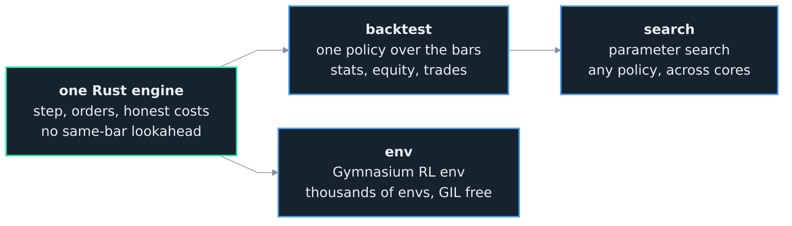
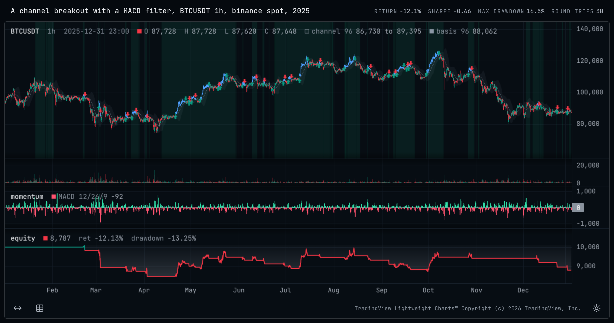

<h1>OCEΛNO <small><code>probatum</code></small></h1>


<div style="padding-top: 0px;">
  <a href="https://github.com/atOCEANO/probatum/releases"></a>
  <a href="https://www.python.org/downloads/"></a>
  <a href="https://www.rust-lang.org/"></a>
  <a href="https://gymnasium.farama.org/"></a>
  <a href="https://github.com/atOCEANO/probatum/releases"></a>
  <a href="https://opensource.org/licenses/MIT"></a>
</div>

<sub>
  <b>Introduction</b> &nbsp;•&nbsp;
  <a href=".Documentation/Research_Guide.md">Research Guide</a> &nbsp;•&nbsp;
  <a href=".Documentation/RL_Guide.md">RL Guide</a> &nbsp;•&nbsp;
  <a href=".Documentation/Charts.md">Charts</a> &nbsp;•&nbsp;
  <a href=".Documentation/Python_API.md">Python API</a> &nbsp;•&nbsp;
  <a href=".Documentation/Specification.md">Specification</a> &nbsp;•&nbsp;
  <a href=".Documentation/Venue_Notes.md">Venue Notes</a> &nbsp;•&nbsp;
  <a href=".Documentation/Validation_Guide.md">Validation Guide</a> &nbsp;•&nbsp;
  <a href=".Documentation/Decisions.md">Decisions</a> &nbsp;•&nbsp;
  <a href=".Documentation/Architecture.md">Architecture</a> &nbsp;•&nbsp;
  <a href=".Documentation/Contributor_Guide.md">Contributor Guide</a>
</sub>

<br>
<br>
<br>
<br>

## Introduction

`probatum` is **a bar-level crypto market simulator: a Rust core with a small Python surface.** Give it a table of candles and it stands in for the exchange: you step forward one bar at a time, place the order types a real venue offers, and read back your balance, position, and equity, with the real fees, funding, and slippage charged as you go.

The point is research speed. A single backtest, a parameter search over thousands of configurations, and a batched reinforcement-learning rollout all run on the same engine through one API, so the simulator is never the part you rebuild between experiments. You write a strategy or an agent once, against one fill model and one set of costs, and move between those jobs without reconciling separate simulators or second-guessing which costs each of them charged. The honest market stays a fixed point; only the question you are asking changes.

The whole engine is one small loop: load candles, place an order if you want to, call `step` to advance exactly one candle, read your new state, repeat until the data runs out. Everything else, the RL env and the backtester, is a thin wrapper that drives that same loop for you.

**Embeddable, not a framework.** You own the loop, so it drops into a system you already have instead of forcing you into its own. The core knows nothing about rewards or indicators; it advances a candle and returns a state. That is what lets one engine serve both a five-line backtest and a batched RL rollout, and it is why each word of the name is a fact rather than a brand. The chart layer sits outside that core and holds to the same rule: it computes nothing and knows no indicator names, it draws the arrays you hand it.

<br>

<div align="center">
  
  <p style="margin: 0;"><i>One engine and one fill model behind a backtest, a Gymnasium RL env, and a parameter search</i></p>
</div>

<br>
<br>

## Scope and fidelity

It **does**: event-driven bar simulation, thousands of parallel runs over one shared series, the order types a real venue offers, a cost model (maker/taker fees, perp funding, a spread, slippage and market impact read off the bars before each fill, a liquidity budget per bar), a small Python API, and a chart layer that draws a run and your own arrays into one self-contained HTML file.

It **does not**: model the full order book (L2), latency, or queue position, and it places no live orders. This is the bar-level, approximate member of a planned family; a future sibling is a tick and L2 engine at higher resolution. At bar granularity the fill model cannot see the intrabar path, so it can be slightly more generous than a live book would be; the costs it charges are the real ones. The bar-level resolution limits are recorded in [0012](.Documentation/Decisions.md).

**Who it is for.** Quant and machine-learning researchers. Not market makers or high-frequency desks, who run C++ and FPGA next to the exchange and need the order book this tier does not model. One decision per candle is the resolution most research works at.

**How it differs from what you already use.** If you have driven a vectorized backtester, you know it cannot express a stop or a flip whose fill depends on the path the price took; probatum can, and runs thousands of such paths in parallel. If you have driven a general backtesting framework, you know it owns your loop; here you own it. If you have used an off-the-shelf RL trading env, you know the fills are a toy; here the backtest, the RL env, and the sweep share one fill model and the same costs.

<br>
<br>

## How it works

You hand the engine your bars and walk it forward one bar at a time. On any bar you can place an order, a market buy or sell, a limit, or a stop, then call `step` to advance exactly one bar: it resolves whatever is pending, marks your account, its balances, position and equity, at the bar's close, and hands back that bar. Repeat to the end of the data. That loop is the whole engine; the backtester and the RL env are wrappers around it.

The rule that keeps you honest is one bar of delay: you decide on the close of a bar and the order fills on the **next** one, never the bar the decision saw. That guard against same-bar lookahead is what separates a believable backtest from a fooled one.

Point it at real candles with the sibling [`exchange-router-service`](https://github.com/atOCEANO/exchange-router-service), which hands back a ready-to-use DataFrame:

```python
from exchange_router_client import ExchangeRouterClient

with ExchangeRouterClient("http://localhost:8040") as client:
    candles = client.get_candles("binance", "spot", "BTCUSDT", interval="1h", limit=5000)
```

Then step through it. `probatum.Data` reads that frame, which names its venue, market, symbol and interval itself, and `probatum.Engine` opens an account on it at a venue. Here a plain momentum rule: long above the last day's average, flat below it.

```python
import probatum

data = probatum.Data(candles)
close = data.close                             # a read-only view of every close
engine = probatum.Engine(data, "binance_spot")
bar = engine.reset()
while not engine.done():
    i = bar.i
    if i >= 24:                                # a day of hourly history
        average = close[i - 24:i].mean()
        if engine.position == 0.0 and close[i] > average:
            engine.buy(0.1)                    # decided now, fills on the next bar
        elif engine.position > 0.0 and close[i] < average:
            engine.close()                     # flatten below it
    bar = engine.step()

print(engine.equity, engine.position)          # account value and position at the end
```

<br>
<br>

## Ways to drive it

`probatum.backtest(policy, data, venue)` runs a policy on a Data at a venue and returns its `Result`: an array of weights or quantities, run whole in Rust in one call, a `Strategy` deciding at each close, or a trained agent. `probatum.Engine` is the same account in a loop you own, as above, and `probatum.env` steps many of them together for an agent. The venue is an argument of each, a preset's name or a `probatum.Venue`, so a cost has one place to be given and cannot arrive twice ([0002](.Documentation/Decisions.md)).

### Backtest

A `Strategy` class with `init` and `next`. `init(data)` runs once over the whole Data, where indicators are computed over every bar at once, and `next(bar, account)` runs at each close and places orders through the account, which fill on a later bar. Set `warmup` to the longest history a decision reads and `next` is not called until that many bars exist, which closes what an early guard was for: on an early bar `close[i - 50]` is a negative index, numpy resolves it from the **end** of the array, and the rule reads prices from the future without raising anything.

```python
import probatum


class BuyDip(probatum.Strategy):
    warmup = 1                                # next() waits until a previous bar exists

    def init(self, data):
        self.close = data.close               # a read-only view of the closes

    def next(self, bar, account):
        i = bar.i
        if account.position == 0.0 and self.close[i] < self.close[i - 1]:
            account.buy(0.01)                 # buy after a down bar
        elif account.position > 0.0 and self.close[i] > self.close[i - 1]:
            account.close()                   # close into the next up bar


result = probatum.backtest(BuyDip(), data, "binance_spot")
print(result.stats["sharpe"], result.stats["max_drawdown_pct"])
print(len(result.trades), "round trips")
```

The account's verbs mirror a venue's: `buy` and `sell` at market, at a `limit`, or once a price reaches a `stop`, with `tif`, `post_only` and `reduce_only`; `buy_value` and `sell_value` in the quote currency; `bracket`, a stop and a take-profit as one OCO pair; `close`, `cancel`, `replace` and `cancel_all`; and `target`, each instrument to a weight of equity. The position is netted, long, short or flat, and never short on spot. The statistics, the round trips and every table a run records are in the [Python API](.Documentation/Python_API.md#backtesting).

### Indicators

`probatum.ta` carries 30 functions, a small closed set rather than an attempt at ta-lib. Every one returns **one value per bar** with the warm-up as a gap and never a shorter array, so the same object drives the rule and draws on the chart with no padding decision in between.

```python
class Cross(probatum.Strategy):
    def init(self, data):
        fast, slow = probatum.ta.ema(data.close, 20), probatum.ta.ema(data.close, 60)
        self.up = probatum.ta.crossover(fast, slow)          # a cross, not a level
        self.trend = probatum.ta.adx(data.high, data.low, data.close).adx
        self.warmup = 80
```

`shift`, `crossover` and `crossunder` are there for a reason beyond convenience. Written by hand, `values[i - n]` on an early bar is a negative index, which numpy resolves from the end of the array and reads the future in silence; computed once as an array there is no index left to get wrong. `crossover` returns booleans and pads with `False` rather than `NaN`, because `bool(nan)` is `True` and a warm-up that reads as a signal is the one version of this that would be dangerous.

An indicator library is mostly somebody's opinion about warm-up and smoothing, so each function states its own where implementations differ: `ema` seeds from the first window's average rather than its first value, `rsi` and `atr` use Wilder's smoothing, `stdev` is population because that is what `bbands` needs. The alternative to a stated convention is not no convention, it is yours, unwritten. Full list in the [Python API](.Documentation/Python_API.md#indicators).

### Reinforcement learning

A Gymnasium vector environment of accounts at a venue on a Data, stepped together in Rust. Each account is a backtest's, through the same fills, costs, funding and liquidation, and each environment draws its episodes from a stream of its own, so an episode runs again as a backtest from its start. You choose what the agent sees (the candles, or your own features), how it is rewarded (the log return, a differential Sharpe, or a function over the batched state) and what its actions are (target weights, discrete positions, or limit orders).

```python
def reward(state):                                 # batched, one value per env
    return state.log_return - 0.5 * state.drawdown ** 2

env = probatum.env(data, "binance_perp", window=64, features=my_features,
                   reward=reward, num_envs=4096, seed=0)
obs, info = env.reset(seed=0)                      # (4096, D) float32
for _ in range(1000):
    actions = policy(obs)                          # (4096, N) target weights
    obs, reward, terminated, truncated, info = env.step(actions)
    # 4096 envs stepped in parallel, GIL released; an ended episode resets
    # on the next step, its start and number in info
```

Or skip the loop and hand it to Stable-Baselines3, which trains on the same env, and judge the agent with the same backtest as a rule, on bars it has not seen:

```python
from stable_baselines3 import PPO

agent = PPO("MlpPolicy", probatum.sb3.wrap(env))       # A2C and SAC swap in
agent.learn(total_timesteps=100_000)
result = probatum.backtest(agent, later, "binance_perp", features=my_features)
```

The observation, reward, action, and autoreset contract, the full training examples and the backtest of an agent are in the [RL Guide](.Documentation/RL_Guide.md).

### Parameter search

Search a policy's parameters for the setting that maximizes an objective. `probatum.search` runs each trial as a full backtest on the bars of a `probatum.Data` before a holdout, and returns a `probatum.Study` of every trial.

```python
import numpy
import probatum

def crossing(data, fast, slow):                   # the parameters, as keyword arguments
    up = probatum.ta.ema(data.close, fast)
    down = probatum.ta.ema(data.close, slow)
    weights = numpy.full(len(data), numpy.nan)    # NaN holds the position
    weights[probatum.ta.crossover(up, down)] = 1.0
    weights[probatum.ta.crossunder(up, down)] = 0.0
    return weights

space = {"fast": probatum.Int(5, 40), "slow": probatum.Int(40, 200, step=10)}
study = probatum.search(crossing, space, data, "frictionless", sampler="random",
                        trials=200, holdout=0.3, seed=7)   # search 70%, hold 30% back
print(study.best_params)
print(study.best_score)                           # in-sample: the best of 200 tries
held = study.evaluate_holdout()                   # the one run on bars no trial saw
print(held.stats["sharpe"])
```

**Read the second number, not the first.** `best_score` is the maximum of a noisy score over 200 attempts on the bars the search was allowed to see, so it is biased upward by the searching itself, by more the harder you search. `holdout=0.3` runs every trial on the first 70% of the rows and keeps the last 30% for one run of the winner, which `evaluate_holdout()` counts as a look. The gap between the two is what the search invented. Leave `holdout` out and every score is in-sample, which the search warns of ([0032](.Documentation/Decisions.md)).

A Study also judges the search across its trials: `study.summary(null=null)`, given a random search of the same ground, deflates the winner's Sharpe for every trial asked and prints the probability the search overfit, and `study.reality_check()` asks whether any trial beats cash at all ([0033](.Documentation/Decisions.md)).

A random or grid search of a policy that returns weights runs its trials together in Rust, many to a call; a `Strategy` subclass, built for each trial from its parameters, runs them one at a time, across worker processes with `n_jobs=-1`. `objective` takes any statistic's name, and `direction="minimize"` ranks a cost. The default sampler, `"tpe"`, needs optuna, and the workers need cloudpickle, which the `search` extra installs ([Install](#install)); the [Python API](.Documentation/Python_API.md#search) covers the policy, the space, the samplers and the Study in full.

### Judging the result

`result.summary()` shows the run beside buying and holding, and `probatum.stats` is what you read after it. The first thing to look at is where the money went, because a large share of what looks like alpha in crypto is a funding carry, and a larger share of dead strategies died on the fee line rather than on the idea.

```python
from probatum import stats

print(result.summary())                         # the headline, its Sharpe's interval read
stats.decompose(result)                         # the price pnl, each cost, the turnover
stats.trade_stats(result)                       # payoff, expectancy, worst losing streak
stats.period_returns(result, by="month")        # or by hour, day, week, quarter or year
probatum.compare({"cheap": a, "dear": b})       # several runs, side by side
```

`decompose` splits the change in equity into the price pnl and each cost, which make up the whole of it: the costs are positive amounts paid away, so they subtract.

How much friction a policy survives is a run of its own. `probatum.cost_curve(policy, data, venue)` runs it again with every cost the venue charges for trading, its fees, spread, slippage and impact, multiplied together by 0, 0.5, 1, 2 and 4, and `probatum.breakeven_bps(policy, data, venue)` finds the round-trip cost at which it stops making money, so "this dies at 8 basis points a round trip and you pay 6" is a number you read rather than guess, worth more in the first week than any probability. `probatum.capacity(policy, data, venue, balances=[...])` runs it at several balances, to show where its own size starts to cost it ([0045](.Documentation/Decisions.md)).

Read `trade_stats` before any of the ratios. A win rate and a profit factor are the same pair for a rule that grinds out small wins and for one that is short gamma waiting for the bar that ends it, and a 70% win rate at a payoff of 0.3 is a losing rule; `result.summary()` shows the win rate beside the profit factor and never one without the other. Then `period_returns`, because "the whole edge is one quarter" is the answer a single number cannot give.

For how far the numbers can be trusted, `probatum.stats` gives each statistic of a run its interval, named for its method: the Sharpe's by the delta method over a long-run variance that autocorrelation widens and never narrows, with its probability of beating a benchmark and the track record that would show it, the others by a bootstrap of the returns or of the round trips. It also tests two Sharpes on the same bars and measures alpha and beta against buying and holding, and `result.summary()` shows the run with its intervals ([Python API](.Documentation/Python_API.md#inference)). `probatum.stats.deflated_sharpe(study, null)` asks whether a search's winner beats what the best of that many trials would have reached by luck; it requires a random-search null and refuses to guess one.

### Looking at the result

The five paths above produce numbers. `result.chart()` is how you look at a run: its candles, the fills on the bars they happened on, the account's equity with its drawdown shaded onto it, a trade log, and any array of your own beside them. `data.chart()` draws bars with no run.

```python
import numpy as np

import probatum
from probatum.chart.marks import Background, Band, Histogram, Level, Line

result = probatum.backtest(Channel(), data, "binance_spot")
strategy = result.policy                      # the copy of the strategy the run used

# the bars the rule was in the market, a round trip still open at the end running
# to the last, its bars the run's placed on the Data's rows
rows = np.searchsorted(data.time, result.time)
held = np.zeros(len(data), dtype=bool)
for trade in result.trades:
    last = rows[-1] if trade["open"] else rows[trade["close_bar"]]
    held[rows[trade["open_bar"]]:last + 1] = True

result.chart(                                 # every array here is the strategy's
    Background(strategy.uptrend, fill="#2fe0a814"),
    Band(strategy.upper, strategy.lower, "channel 96", fill="#8b97a514"),
    Line(strategy.basis, "basis 96", width=1, style="dashed"),
    Histogram(strategy.hist, "MACD 12/26/9", panel="momentum",
              color=np.where(strategy.hist >= 0.0, "#2fe0a8", "#ff5470")),
    Level(0.0, panel="momentum", style="dotted"),
    candle_color=np.where(held, "#4d9fff", None),
).show()
```

Those are the arrays the rule decided on, handed over as they are. Nothing here recomputes an indicator, because a recomputed copy is a picture of a rule that was never run.

<div align="center">
  
  <p style="margin: 0;"><i>One call, one year of hourly candles. Four panels, their order, their weights and the trade log are the library's; every mark on them is the strategy's own array</i></p>
</div>

<br>

**Everything above the fold came free**, and everything else is one more mark in the same list. You add a `Line` for a moving average or an equity curve of your own, a `Band` for a channel or a conditional shading, a `Level` for a threshold, `Markers` for a glyph on every bar a condition holds, a `Background` for a regime, a `Histogram` for anything per-bar. Any of them goes on the candles or on a panel of its own, just by naming one, and panels are stretched, pinned to a range, put on a log scale, or hidden. Every mark takes one colour or **one colour per bar**, so a line can carry a second variable in its own shading, and the candles themselves can be tinted the same way. A series can even be drawn past the last candle, which is what an Ichimoku cloud needs.

None of it is required. Bars alone are a chart, an array finds its own home, and a run brings its own panels.

**`show()` draws it in the notebook cell**, inline, where you are already working. No second window, no server, no separate viewer.

**The chart stays in the notebook.** It is stored in the `.ipynb` itself, so opening that file next year shows the same charts, scrollable and zoomable, with no kernel running and nothing re-executed. Send somebody the notebook and they see what you saw.

**`save()` writes one HTML file** you open in a browser by double-clicking it, for the people who want the picture without the notebook.

```python
result.chart().save("reports/run.html")
```

It computes nothing and knows no indicator names: pass the strategy's own arrays and the line on screen cannot drift from the line that made the decision.

The [Charts](.Documentation/Charts.md) page shows every one of those marks with the picture it draws, the length contract that keeps a series on the bar it belongs to, and what cannot be charted.

<br>
<br>

## Speed

Throughput depends on which path you drive, and they differ by orders of magnitude, so it is worth knowing which one you are on. Measured on a 28-thread x86_64 box against the built wheel over a 2,000-bar series:

| Path | Throughput | What bounds it |
| :--- | :--- | :--- |
| Single-env raw step | ~1.7M steps/s | the Python-to-Rust boundary, crossed on every `step` |
| `backtest` with a Python `Strategy` | ~111K bars/s | the `next` called on every bar and the views it reads, not the engine |
| Batched RL step | ~760K-1.3M env-steps/s | writing the observation, GIL released |

The single-env rows say something worth internalizing: the engine steps at about 1.7M per second with nothing attached, and a `Strategy` that reads indicators computed once in `init` runs at about 111K, so a backtest stepped from Python is bound by the call to `next` on every bar, not by the engine. A policy given as an array runs in Rust in one call, with no Python on any bar. The batched RL step releases the GIL and moves every env together, bound by building the observation rather than by the fill. A parameter search scales the other way, across processes rather than per bar, so its rate is trials per second and it grows with the cores you give it.

These move with hardware and workload, so treat them as shape, not a promise. Run `benchmarks/throughput.py` for your own machine, and the Criterion bench in `crates/probatum-engine/benches` for the pure-Rust step and the in-core sweep.

<br>
<br>

## Compatibility

A backtest is a number somebody acts on, so **the simulator's behaviour is part of the API, not an implementation detail**. A fill model that shifts quietly between patch releases makes every result you recorded last month unattributable.

From 1.0, a **minor** release will not remove an exported name, remove a keyword, change what a keyword means, or change what a function returns. New keywords arrive with defaults that keep the old behaviour. Beyond that, these are rules you may build on, and changing any of them is a **major** release that arrives with an [ADR](.Documentation/Decisions.md) explaining what was wrong:

- An order decided on bar `i` fills against bar `i + 1`, never the same bar, and a `T`-bar series calls `next` `T - 1` times.
- A bar reaching both a stop and a target books the **worse** exit.
- A liquidation is priced where the margin runs out, so bad debt is unreachable rather than clamped after the fact.
- The statistics are never `NaN` and rank monotonically, so a bad run cannot win a search.
- `probatum.ta` returns one value per bar, warm-up as a gap, never a shorter array.
- A `T-1` array on a chart maps entry `i` to bar `i + 1`.
- `search` holds out the **end** of a series, never a random slice.

Not promised: an indicator's output to the last bit (the recursive ones trade 2e-15 for a 33-fold speedup, and that trade may be made again), anything whose name starts with an underscore, the wording of an error, the chart's JSON spec, and the Rust crates, which are workspace members rather than a published API. The [fidelity limits](#scope-and-fidelity) are limits and not promises: they may become *more* faithful in a minor release, because a simulator getting closer to a real venue is a fix, and your results will move when it does.

<br>
<br>

## Install

Every [release](https://github.com/atOCEANO/embeddable-market-simulation-library/releases) carries prebuilt wheels, so installing one needs no compiler. **emsl is not on PyPI**, so install the wheel for your platform by its URL.

Each build covers one platform, and one wheel per platform serves **Python 3.13 and up**, because the extension is stable-ABI:

| Platform | Wheel | Built |
| :--- | :--- | :--- |
| Linux x86_64 | manylinux | every release |
| Linux aarch64 | manylinux | best effort, cross-compiled; a release may not have one |
| macOS, Intel and Apple silicon | one universal2 file covering both | every release |
| Windows x64 | win_amd64 | every release |

Any other platform, Windows on ARM for instance, builds from the source archive (the last command below), which needs the Rust toolchain. For another release, change the version in the URL, in both the tag and the file name.

```bash
# Linux x86_64
pip install "emsl @ https://github.com/atOCEANO/embeddable-market-simulation-library/releases/download/v1.3.2/emsl-1.3.2-cp39-abi3-manylinux_2_17_x86_64.manylinux2014_x86_64.whl"
# Linux aarch64
pip install "emsl @ https://github.com/atOCEANO/embeddable-market-simulation-library/releases/download/v1.3.2/emsl-1.3.2-cp39-abi3-manylinux_2_17_aarch64.manylinux2014_aarch64.whl"
# macOS, Intel and Apple silicon
pip install "emsl @ https://github.com/atOCEANO/embeddable-market-simulation-library/releases/download/v1.3.2/emsl-1.3.2-cp39-abi3-macosx_10_12_x86_64.macosx_11_0_arm64.macosx_10_12_universal2.whl"
# Windows x64
pip install "emsl @ https://github.com/atOCEANO/embeddable-market-simulation-library/releases/download/v1.3.2/emsl-1.3.2-cp39-abi3-win_amd64.whl"
# anything else, built from source
pip install "emsl @ https://github.com/atOCEANO/embeddable-market-simulation-library/releases/download/v1.3.2/emsl-1.3.2.tar.gz"
```

The optional extras go in brackets before the `@`, and stack:

| Extra | Pulls | For |
| :--- | :--- | :--- |
| `data` | pandas, pyarrow | DataFrame and parquet input |
| `search` | optuna, cloudpickle | `probatum.search`'s TPE sampler and its workers |
| `sb3` | stable-baselines3 | the Stable-Baselines3 adapter |

```bash
pip install "emsl[search,sb3] @ <the URL for your platform, from above>"
```

Building from source needs the Rust toolchain ([rustup](https://rustup.rs)), and pip drives the build for you:

```bash
pip install "git+https://github.com/atOCEANO/embeddable-market-simulation-library.git@v1.3.2"
```

From a local checkout, either as a plain install or as a development build:

```bash
git clone https://github.com/atOCEANO/embeddable-market-simulation-library.git
cd embeddable-market-simulation-library

pip install .                    # a normal install from the checkout
                                 # or, to work on the library itself:
pip install maturin
maturin develop --release        # compiles the abi3 extension into the active venv
```

Or build the wheel once and install that copy wherever you need it:

```bash
maturin build --release --out dist
pip install dist/*.whl
```

`numpy` and `gymnasium` install with the package either way.

<br>
<br>

## Building and validating

The pure-Rust crates validate locally with cargo; the Python surface validates on a Docker gate that builds the one abi3 wheel and runs the test suite across Python 3.13 and 3.14. The riskiest code is adversarially verified, a process that has caught real bugs before they shipped; the full workflow is in the [Validation Guide](.Documentation/Validation_Guide.md).

```bash
cargo test -p probatum-core -p probatum-engine    # pure-Rust core
cargo clippy --workspace --all-targets -- -D warnings
docker build --target test313 .                   # wheel + pytest on Python 3.13
```
